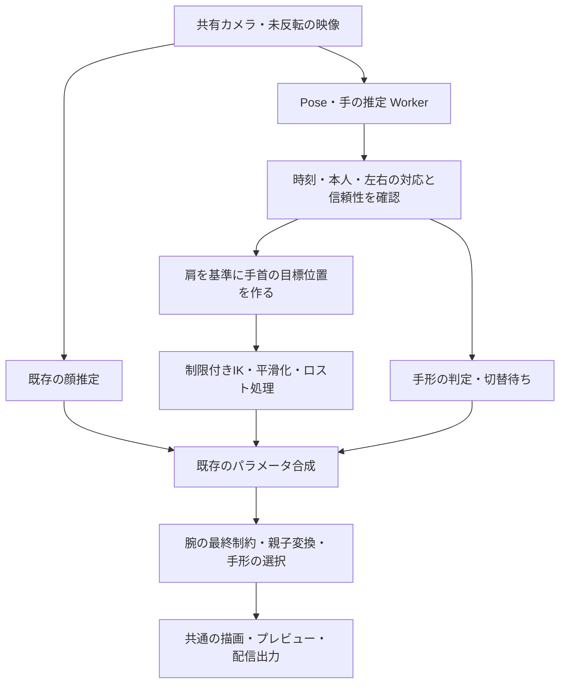

# 腕・手のトラッキング設計

2026-10-31 CO。設計案。アプリへの実装、カメラでの実測、モデル素材の作成はまだ行っていない。

実装順序・担当・変更範囲・確認条件は [腕・手のトラッキング実装計画](arm-tracking/README.md) にまとめ、AT-01〜AT-16の16枚に分割した。実装担当へ渡す際は同計画と対象カードを使用する。

## 1. 目指す動き

Webカメラ1台で左右の腕を動かし、手を振る・画面内の方向を指さす・顔の前でピースする・グーを作ることを目指す。優先順位は **不自然に壊れないこと → 動きの連続性 → 入力への忠実さ**。認識できない姿勢を無理に再現しない。

初版は正面寄りの上半身と、画面内での腕の動きが対象。肩・肘・手首を追跡し、手の絵は手のひら側を固定する。胴体・脚の追跡、前腕のひねり、手の甲への切替、指関節すべての連続変形、カメラへ突き出す動きの遠近再現は後の段階とする。肩は腕の基準として測るが、今回の入力で胴体自体は動かさない。

| 要望                         | 初版の動作                                                     |
| ---------------------------- | -------------------------------------------------------------- |
| 手を振る                     | 肩・肘・手首の移動と面内の傾きを連続追従。パーの絵を表示       |
| 指さす                       | 人さし指だけを伸ばした形を認識し、腕と手首で方向を表現         |
| 一回転・逆曲がりを防ぐ       | 有限の関節角度、固定した肘の曲がる側、時間的な連続性で制約     |
| 手が翻って左右が逆にならない | 左右専用の素材、固定した掌面、正の倍率。交差中も腕の所属を維持 |
| 手を顔の前に置く             | 前腕と手を顔・前髪より前に描く。顔との衝突回避は行わない       |
| ピース・グー                 | パー・グー・指さし・ピースの4種類を左右独立に切替              |

「掌面の固定」は手の絵の表裏を固定するという意味で、手首の位置や画面内の傾きを固定する意味ではない。手を裏返しても、キャラクターの手は掌面のまま動く。

## 2. 現在の実装との違い

コードで確認した現状:

| 場所                                                      | 現状と変更点                                                                                                               |
| --------------------------------------------------------- | -------------------------------------------------------------------------------------------------------------------------- |
| `packages/tracking/src/source/source.ts`・`landmarker.ts` | 共有カメラ1本で FaceLandmarker のみ実行。Pose と手の推定を追加する                                                         |
| `packages/tracking/package.json`                          | `@mediapipe/tasks-vision` は `1.0.1` 固定。インストール済み型に PoseLandmarker・GestureRecognizer がある。実機対応は未検証 |
| `packages/contracts/src/index.ts`                         | `TrackingFrame.detected` は顔の検出状態。腕の検出状態・時刻は別の契約にする                                                |
| `packages/tracking/src/mapping/producer.ts`               | 顔用の校正・ミラー・One Euro・ロスト処理。腕には左右別の状態管理が必要                                                     |
| `packages/core/src/setup/step2.ts`                        | `ArmL`・`ArmR` で腕全体を肩から最大±30°回す。肘と手首は独立していない                                                      |
| `packages/core/src/deform/pipeline.ts`                    | パーツの親子変換とワープがある。描画順は `Model.drawOrder`。汎用の腕IKや骨はない                                           |
| `apps/desktop/src/modes/studio/runtime.ts`                | 複数の同じIDのレイヤーを合成可能。顔と腕を別producerとして既存の `tracking` 段へ入れられる                                 |
| `packages/core/src/hairDynamics/frame.ts`                 | 通常評価と物理用の補助評価がある。腕も共有の評価経路で適用し、スタジオだけの後加工にしない                                 |

既存の[カード95](step4/cards/95_arm-tracking.md)は腕の入力を `ArmL`・`ArmR` へ渡す案。今回の肩・肘・手首・手形には不足するため、本設計で具体化する。[カード76](step4/cards/76_joint-prototype.md)・[82](step4/cards/82_joint-contract.md)・[89](step4/cards/89_joint.md)の関節設計と合わせ、初版は分割素材方式を優先する。1枚の腕にも対応するという旧カードの完成条件を、この初版の完成で達成扱いにはしない。

## 3. 全体構成

認識側は人間の観測値を返し、モデルの肩幅や腕の長さを知らない。モデルへの合わせ込みと関節の計算は `packages/core`、カメラと認識は `packages/tracking`、両者の接続は `apps/desktop` に置く。パッケージ間の参照は既存どおり schema・contracts を通す。

### 推定器

- **PoseLandmarker**: 肩・肘・手首。1人を対象にし、セグメンテーションは初版では無効。
- **GestureRecognizer**: 最大2手のランドマーク・左右候補・手形候補を得る。HandLandmarker を同時に追加して二重に手を推定しない。
- 既存の FaceLandmarker は継続使用する。全身の仕組みへ一括置換することは今回の前提にしない。

Pose は画像座標と推定3D座標を返し、GestureRecognizer は手の点列と手形を返す。既成の手形には `Open_Palm`・`Closed_Fist`・`Pointing_Up`・`Victory` がある。ただし、横や斜めへの指さしの精度は名称だけから保証できないため、人さし指の伸展と他の指の屈曲を手の局所座標でも判定し、実測で採用条件を決める。[Pose公式資料](https://developers.google.com/edge/mediapipe/solutions/vision/pose_landmarker/web_js)、[Gesture公式資料](https://developers.google.com/edge/mediapipe/solutions/vision/gesture_recognizer/web_js)。

推定の深度は補助情報とする。Poseの腰基準の3D座標と、手の推定器の手基準の3D座標を、そのまま同じ座標系として足し合わせない。

## 4. 自然な腕を作る制約

### 4.1 座標と左右

1. 推定器へは未反転のフレームを渡す。カメラプレビューだけのミラーと、キャラクターへの左右の割当を区別する。
2. 観測の `left/right` は演者自身の左右。モデルの `L/R` はキャラクター自身の左右。画面上のx座標の大小で所属を決めない。
3. 現行の目と同じく、ミラーONでは演者の右腕をモデルの左腕へ、OFFでは右腕へ割り当てる。位置の反映もこの一箇所で行い、二重反転を防ぐ。
4. 正規化画像座標は `(x × 幅, y × 高さ)` に直してから角度・距離を計算する。縦横比の異なる0〜1座標をそのまま角度計算に使わない。
5. 手首と肘の位置は肩の中心・肩の線を基準にし、校正した演者の腕長で正規化してモデルの腕長へ写す。モデルの骨の長さは固定し、毎フレームの検出距離で伸縮しない。
6. モデル側では体の追従・呼吸などを含む親の変換を受ける。画面座標を直接パーツへ足して体の動きを二重に適用しない。

手の対応付けは、Poseの同じ側の手首との距離、前フレームからの移動、左右の分類候補を組み合わせ、最大2手を重複なく割り当てる。左右の分類スコアだけを位置の信頼性として使わない。顔・肩との位置関係と時間的連続性で対象の演者を保持し、別の人の手へ安易に乗り換えない。

両手が交差・重複して区別できない間は、対応付けを未確定にする。判別不能な映像から所属を保証することはできないので、誤った側への切替より保持・復帰を選ぶ。

### 4.2 肩・肘・手首

手首の目標位置に対し、固定した上腕長と前腕長で肩角度・肘角度を求める **制限付き2関節IK** を用いる。肘が見える間はその位置も評価に含め、同じ手首位置で肘だけが跳ぶことを抑える。

次の値は人体の限界値ではなく、正面の2Dモデル用の**試作開始値**。モデルの素材と受け入れ動作を見て狭める。

| 関節 | 初期の制約案                                         | 意味                                             |
| ---- | ---------------------------------------------------- | ------------------------------------------------ |
| 肩   | 腕を下げた向き0°、外へ上げる向きを正として −25〜160° | 胸側へ少し寄せ、横・頭の近くへ上げられる有限区間 |
| 肘   | 伸ばした姿勢0°、曲げ量0〜145°                        | 曲がる側は左右別に設定し、実行中は固定           |
| 手首 | 前腕に対する基準姿勢から −40〜40°                    | 掌面を保った面内の傾きだけ                       |

角度の符号は左右を正規化してから、描画座標へ変換する。基準画像が肘を曲げた姿勢なら、その基準角度からの差分を描画へ適用する。

一つの角度の上限だけでは見た目を保証できない。肩・肘・手首を組み合わせた姿勢にも、モデルごとの許可範囲を設ける。前腕・手の合成角度にも体に対する360°未満の連続した範囲を持たせ、一周分の回転を蓄積しない。最初は手を振る・前を指す・顔の前へ手を寄せる姿勢と、その間の遷移を通る範囲に絞る。

### 4.3 解の選択と時間的な制約

- 目標が腕の届く範囲外なら、許された姿勢集合の最寄りへ近づける。手首への完全一致より関節制約を優先する。
- 一般のIKには肘の曲がる側が異なる解があるが、このモードではモデルに登録した側だけを使う。腕が伸び切る付近でも、その符号を再計算して切り替えない。
- 肩角度・肘角度を単独にクランプして終わらず、範囲の境界も候補に含めて手首誤差・肘誤差・前回からの角度差を評価する。到達不能でも有限で連続した姿勢を返す。
- `atan2` の±180°境界をそのまま補間しない。前回と連続する角度候補を許可区間内で選ぶ。360°を無期限に足し込むunwrapもしない。
- 信頼できる目標位置をOne Euro等でならし、解いた後にも角速度・加速度を制限する。最後にもう一度関節の許可範囲へ収める。遅延が積み重なる多段の強い平滑化は避ける。
- 急な飛び値、ゼロ長ベクトル、NaN、時刻の逆行は不採用。停止・再開後の大きな `dt` で一気に動かさない。停止時にはフィルタを再初期化する。
- 制限の直前から徐々に減速し、境界でガクッと止まる感触を減らす。通常の手振りまで遅くならないよう実測で調整する。

2Dで肘の曲がる側を固定するため、実際の腕を大きくひねって投影上の曲がる側を変える動作は、そのまま再現しない。この制約内で自然に見える姿勢へ寄せる。

### 4.4 手首・掌面

手首から中指付け根などへ向かう掌の軸を使い、指先の細かい揺れを手全体の回転にしない。軸が短い・手が横を向いて潰れて見える場合は回転の更新を止める。グーでも指先ではなく掌の点を使う。

手形ごとに手首の接続点と基準の指方向を保存する。指さし中は人さし指の方向も候補にするが、手首の可動域を超えて回転させない。上向き限定でなく、左右・斜めを向いた指さしを検証する。

素材・実行時変換とも左右別に保持する。掌の法線から表裏を切り替えず、横倍率を負にする処理・UVの左右反転を使わない。ミラー切替は反対側の専用素材への対応変更で行う。

## 5. 手の形を安定して切り替える

| 内部の形 | 見た目 | 主な判定材料                                                 |
| -------- | ------ | ------------------------------------------------------------ |
| `open`   | パー   | 複数指の伸展と `Open_Palm`                                   |
| `fist`   | グー   | 指の屈曲と `Closed_Fist`                                     |
| `point`  | 指さし | 人さし指の伸展、他の指の屈曲。向きは別に求める               |
| `peace`  | ピース | 人さし指と中指の伸展、薬指と小指の屈曲、指の開きと `Victory` |

- 指の曲がりは関節間の角度などで判断し、「指先が付け根より画面上にあるか」だけでは決めない。
- 判定候補が120ms程度継続してから切り替える。開始・維持の閾値に差を付け、境界でパーとグーを連打しない。時間で判定し、fps依存の固定フレーム数にしない。
- `unknown`・低信頼を5番目の手の絵にしない。短い不明期間は直前の形を保ち、長い場合は設定した休止形へ戻す。手形の切替待ちは腕の追従を遅らせない。
- 初版の描画は確定した1種類へ切り替える。異なる指を半透明で長く重ねるフェードはしない。共通の手首位置と手の大きさで切替の跳びを防ぐ。
- 左右それぞれに「自動／パー／グー／指さし／ピース」を用意する。固定を選んでも腕は追従する。
- 未登録の手形は休止形など登録済みの形へ戻し、素材がないことを画面に表示する。別の側の絵を反転して補わない。

## 6. 見失ったときの動き

顔、左右の腕、左右の手形を別々に管理する。顔が隠れても、腕の観測が有効なら腕を続ける。片腕だけ見失っても反対側を止めない。

以下の時間も試作開始値。最後に有効だった**観測時刻**から測り、再通知された古い結果で延長しない。

| 状態          | 条件と動作                                                                |
| ------------- | ------------------------------------------------------------------------- |
| `tracking`    | 肩・肘・手首が有効。通常追従                                              |
| `inferred`    | 肩と手首は有効、肘だけ不明。固定した曲がる側と前回姿勢でIKを続ける        |
| `holding`     | 手首または左右の所属が不明。約200msまで最後の安全な姿勢を保持。外挿しない |
| `returning`   | 不明が続く。約500msをかけ、関節空間で休止姿勢へ戻す                       |
| `idle`        | 休止姿勢。手は休止形。推定の再取得を待つ                                  |
| `reacquiring` | 同じ側の有効な観測が約100ms継続したら、約200msで追従へ復帰                |

手の詳細だけ見失った場合、Poseの手首で腕を継続し、手首の相対回転と手形だけ保持・復帰させる。Poseと手の観測が同じフレームなら手の手首で補正できるが、時刻差が大きい結果を混ぜない（初期上限80ms、実測で調整）。肩を見失った場合は最後の基準を短く保つだけで、新しい基準を推測し続けない。

初版の長期ロストは休止姿勢への復帰を既定にする。ON/OFF、カメラ変更、ミラー変更、モデル変更、校正のやり直しでは追跡の履歴・左右対応・手形の候補をリセットする。ミラー変更時は瞬時に両腕を交換せず、休止姿勢を経て再取得する。

## 7. モデルに必要な仕組み

### 分割素材を用いた初版

片側につき「上腕／前腕／手」を基本とし、手は4種類。袖・装飾は上腕または前腕に付属させる。肩・肘・手首に親子の変形グループを置き、関節を中心に回す。関節のつなぎ目は重ね代と必要な補正絵・メッシュ補正で隠す。

手首位置・手の大きさ・親指の側を全手形で一致させる。肘の内側が潰れる、肩と袖に穴が開く等は追跡精度では直らないため、素材と関節をカメラなしで先に検証する。

既存の腕1枚のモデルは今の `ArmL`・`ArmR` を維持する。高度な腕追従を有効にする際に、分割素材と関節設定の不足を示す。1枚の画像を自動で切り抜いて対応済みにしない。1枚腕へのスキニング／関節ワープは、カード76の比較を経て別の対応方式として追加する。

実モデルの素材を作る段階では [model-authoring手順](../tools/model-authoring/README.md)を使う。元画像を毎回添付して画像生成し、配置は等倍率と平行移動を基本に `grid_check.py --all` で全パーツを確認する。配置のルールと、実行時に関節で回すことを区別する。ユーザーが編集したプロジェクトは組み立て直さず、差替え時は保存・終了とバックアップの手順を守る。

### 保存形式の案

- `Model.armRigs?: ArmRig[]`: 左右、上腕・前腕・手のグループID、体側の親ID、関節の基準位置・角度・長さ、肘の曲がる側、角度と組合せの制限、休止姿勢、手形別パーツID・接続点、制御するパラメータIDを保存する。
- `Project`内の腕追従設定: 左右の有効化、モデルへの追従量、手形の自動／固定、休止時の形。リグの存在とカメラ追従のON/OFFは別にする。
- `Environment`内の腕校正: カメラID、撮影条件、演者の腕長と基準姿勢。モデルの腕長はここへ保存しない。カメラ条件の変更時に校正を再確認する。
- 時刻、フィルタ、追跡ID、ロスト状態、現在の手形候補はセッション状態とし、プロジェクトには保存しない。

検証では、有限で正の骨長、許可範囲内の休止姿勢、角度区間の順序と360°未満の幅、左右で重複しない関節の所有、親子の循環、実在するパーツ・パラメータ・手形の参照を確認する。不正な片側のリグは理由を示して無効にし、無関係な顔や反対側のリグは継続できるようにする。

パラメータは肩 `ArmShoulderL/R`、肘 `ArmElbowL/R`、手首 `HandAngleL/R` を新設する案。単位は度。既存 `ArmL/R` の意味は変更しない。

手形は `HandOpenL/R`・`HandFistL/R`・`HandPointL/R`・`HandPeaceL/R` の0〜1の重みとして既存の合成へ接続し、追跡は一つだけ1を出す。最終表示は重み最大の登録済み1種類を選び、同点時の優先順を固定する。全て0なら休止形。整数の「0=パー、1=グー、2=指さし」を通常の連続パラメータとして補間しない。表情・アニメーションからも同じパラメータで上書きできる。

### 評価・編集との共存

新リグが所有する関節グループは専用とし、旧 `ArmL/R` の回転と二重に適用しない。既存の手動キー・ワープと競合する場合は、セットアップ画面で対象と競合を表示し、明示的な切替として移行する。手動キーを削除・作り直して解決しない。

パラメータ合成後、共通の評価経路で静的な関節制約を適用し、リグの回転差分と手形の表示ゲートを変形パイプラインへ渡す。関節差分は基準姿勢から求め、前回の変形済み頂点へ繰り返し掛けない。手形ゲートは既存の不透明度と乗算し、保存された `visible`・不透明度を毎フレーム書き換えない。

時間的な平滑化は追跡producerに置き、保存されたキーの任意時刻評価は決定的にする。最終の静的制約はアニメーション・表情で上書きされた値にも適用する。専用関節グループへの別の変換・反転や、不正な参照は検証で検出する。制約を迂回するワープ・負倍率の祖先変換があるリグは対応不可として理由を示し、通常のモデル全体の編集まで禁止しない。

モデリング・アニメーションのプレビュー、スタジオ、物理の補助評価、配信出力で同じ関節評価を使う。親の回転・等倍率拡縮は対応し、腕を潰す非等倍率拡縮や非線形ワープは初版では適用先を限定する。肩の接続位置が呼吸などで動く場合も離れないことを検証する。

### 描画順

セットアップのプレビューで、肩付近の上腕は元の重なりを調整し、前腕・手・そこに付属する袖を顔と前髪より前に配置する。初版は固定順とし、観測深度で前後を毎フレーム切り替えない。左右の手が交差する場合も固定の優先順を使う。現実と完全に同じ前後関係にはならないが、ちらつきと突然の入替を防げる。

描画順はプロジェクトに保存する明示的なセットアップ変更とし、カメラONだけで既存の `drawOrder` を書き換えない。

## 8. 認識の契約と性能

### 顔と独立した観測

`TrackingFrame` の顔の意味と時刻を保ち、同じ `TrackingSource` に `onBodyFrame`・腕推定の設定／状態を追加する案とする。`BodyTrackingFrame` はセッション世代、撮影フレームID、単調な撮影時刻、推定完了時刻、映像サイズ、Poseと各手の結果を持つ。それぞれの結果に元の観測時刻と有効／不明を持たせる。

顔の結果が来たことを腕の再観測と扱わず、その逆も行わない。左右別の品質は検出有無・Poseのvisibility・幾何条件・連続性から評価する。SDKが返さない手の各点のconfidenceやpresenceがある前提にしない。現在のSDKの型とモデルの実出力を実装時に照合する。

腕のproducerは `tracking` レイヤーの腕関連パラメータだけを返す。顔の重みや `TrackingFrame.detected` で腕全体を消さない。左右の `parameterWeights` を独立させる。既存の「割当OFF」は腕にも効くよう、顔のカスタム割当とリグ追従のON/OFFの関係をUI上で明示する。初版の腕は専用リグ経由とし、任意の顔用マッピングで関節制約を迂回しない。

ロスト時は有効化中の腕の値そのものを安全な休止姿勢へ戻す。単純にレイヤーの重みを0にして、別の初期値へ急に切り替わる実装にしない。後段のアニメーションが腕を担当している間はその優先順位を維持し、終了後に追跡へ戻す場合も現在の表示姿勢から接続する。

### 推定のスケジューリング

公式のWeb APIは同期推定でメインスレッドをブロックするため、追加するPose・手はWorkerで実行する案を基本とする。WebView2でのGPU・CPU・画像転送の可否は試作の必須項目。[Pose公式資料](https://developers.google.com/edge/mediapipe/solutions/vision/pose_landmarker/web_js)、[Hand公式資料](https://developers.google.com/edge/mediapipe/solutions/vision/hand_landmarker/web_js)。

- カメラは共有し、推定のために二重に開かない。最初はPoseと手を同じWorkerで順番に処理し、顔と合わせたGPU競合を測る。
- 処理中のフレームと最新の待ちフレームだけを保持する。古い待ちフレームは破棄し、キューを積まない。画像の所有権を明確にし、処理後・破棄時に `close()` する。
- 結果は撮影時刻で扱い、世代違い・順序逆転・期限切れは捨てる。プロジェクト変更後に古い結果で腕を動かさない。
- 腕OFFでPoseと手の推定を止め、確保したWorker内のモデル・画像を解放する。顔だけの機能は継続可能にする。
- モデルとWASMは同梱し、実行時のCDN取得を行わない。追加するモデルの版・配布条件・ハッシュを記録する。
- Worker非対応・GPU初期化失敗時はCPU Workerを検証する。両方使えない場合、顔は継続して腕は利用不可と表示する。未計測の重い推定をメインスレッドへ自動追加しない。
- 顔のWorker化は既存カード71と合わせて実測で判断する。追加分だけWorkerへ移しても、GPU共有の負荷が消えるとは見なさない。

通常モードの目標は描画60fps、腕の有効な更新30fps、カメラ画像から表示までの腕の遅延p95 100ms以下。手形の切替は安定待ち込みでp95 250ms以下を初期目標とする。手の形の遅延と腕位置の遅延を別に測る。既存のカメラfps・推定呼出回数だけでは足りず、顔／Pose／手の完了fps、結果の古さ、推定時間、描画の遅いフレームも記録する。

負荷が高い場合は手の推定を15fpsへ下げる軽量モードを用意し、姿勢の30fpsを優先する。通常目標と同等の達成とは記録しない。既存のカメラ自動選択はfps中心なので、手の点が見える大きさ・解像度も含めて選択方針を見直す。手が小さすぎる場合はユーザーに写り方を案内し、無条件に低解像度へ落とさない。

## 9. 画面と準備の流れ

スタジオに「腕・手」を追加する。

1. 「腕をトラッキング」をON。準備不足なら「左腕の肘・手首を設定」など具体的な不足箇所を示す。
2. カメラ映像に肩・肘・手首を表示し、両肩と肘が写る位置へ案内する。腰・全身が写ることを必須にしない。ただし上半身だけでの検出精度は試作で確認する。
3. 楽な姿勢、肘を軽く曲げる、左右それぞれ片手を上げる動作で、腕長・左右・追従範囲を校正する。写っていない肘で校正を完了させない。
4. パーで手を振る、指さし、ピース、グーの見本を順に試す。左右どちらかだけの有効化も可能にする。
5. 通常画面には「なめらかさ」「動きの大きさ」「左右の手形」を置く。手の表裏は初版では固定で、不要な設定項目にしない。

関節の範囲・休止姿勢・素材と描画順はモデリング側の「腕の設定」で調整する。肩・肘・手首をドラッグするだけで安全範囲とつなぎ目を確認できるようにし、カメラがなくてもモデル準備を進められるようにする。

状態表示は左右別に「追従中／肘を補っています／手を見失っています／休止中」。詳細の診断には生の点、採用した点、目標の手首、実際の手首、制限が効いた理由を出し、認識・制約・素材のどこが原因かを確認できるようにする。

## 10. 実装の段階と変更箇所

| 段階          | 実施内容                                                                  | 次へ進む条件                                                   |
| ------------- | ------------------------------------------------------------------------- | -------------------------------------------------------------- |
| A: 認識の試作 | 顔＋Pose＋手を同時実行。左右・交差・上半身・横向きの指さし・OBS負荷を記録 | Workerと同梱モデルが動き、品質・遅延・画角の実測がある         |
| B: 腕のモデル | 分割素材、関節、制限、手の4形、固定描画順をカメラなしで試す               | 手振り・指さし・顔の前への移動で、継ぎ目・逆曲がり・反転がない |
| C: 追従の接続 | 左右の対応、校正、制限付きIK、ロスト、平滑化を統合                        | 両腕独立・顔が隠れる動作・復帰が成立                           |
| D: 手形と操作 | 判定の安定化、自動／固定、設定・保存・旧モデル対応                        | 手形のちらつきがなく、ユーザーが準備から使用まで進められる     |
| E: 受け入れ   | 実モデル・実カメラ・OBSで動作と性能を確認                                 | 下表を満たし、未対応条件が記録されている                       |

初版の完成範囲はA〜E。BやCまでの途中状態を、手を振る・指さし・ピース・グーが完成したとは扱わない。

| 主な変更候補                                                   | 内容                                                                      |
| -------------------------------------------------------------- | ------------------------------------------------------------------------- |
| `packages/schema/src/{types,validate,migrate,rules}.ts`        | リグ・設定・パラメータ・参照検証。新項目なしは旧動作、リグは空、追従はOFF |
| `packages/contracts/src/index.ts`・仮実装                      | 身体観測、機能ON/OFF、左右の状態、腕の評価結果                            |
| `packages/tracking/src/source/`・新規 `pose/`・`hands/`        | 共有キャプチャ、Worker、同梱モデル、点列・手形の抽出                      |
| `packages/core/src/joint/`・`setup/`                           | 制限付きIK、基準姿勢、関節評価、手形選択、セットアップ                    |
| `packages/core/src/eval/`・`deform/`・`hairDynamics/frame.ts`  | 全モード共通の適用、専用グループの所有、物理の補助評価との整合            |
| `apps/desktop/src/services.ts`・`services/`・スタジオのruntime | 既存の顔と腕のproducerを接続。カメラ停止・変更・再取得                    |
| モデリングの腕設定・スタジオの腕設定                           | 関節配置、校正、状態、手形の固定、診断                                    |
| `packages/io/src/project/repair.ts` 等                         | 欠けた手形・削除された関節の参照修復と警告。無関係なキーは維持            |
| `apps/desktop/vite.config.ts`・e2e・計測                       | Worker・モデル同梱、外部通信0、性能と出力確認                             |

schemaVersionは実装着手時の最新版から更新し、契約変更を `docs/contract-changes.md` に記録する。今回の設計だけでは版や契約を変更しない。既存プロジェクトの自動移行でリグを生成したり描画順を変えたりしない。

## 11. 受け入れ条件

数値は実装時に計測する目標で、現在の達成値ではない。自然さは数値だけで判定せず、連続動画とポーズ間の遷移を確認する。

| 確認               | 合格条件                                                                                           |
| ------------------ | -------------------------------------------------------------------------------------------------- |
| 片手・両手の手振り | 左右それぞれ10往復。肩の脱落、肘の反転、余分な一周、関節の目立つ穴が0件                            |
| 指さし             | 左右・上・斜め、各側で維持できる。手首の制限で追えない方向は無理に反転しない                       |
| 顔の前のピース     | 手が顔・前髪より前。顔の検出が切れても腕の有効な追従が続く                                         |
| 手形切替           | 4種類を左右別に各10回。静止中の誤切替0、切替成功率95%以上を初期目標。横向きは別に集計              |
| 掌の表裏・交差     | 実際の手を裏返す・交差する・完全に重ねる。素材の反転0、所属の突然の交換0。不明なら保持へ移る       |
| 片腕の画面外・遮蔽 | もう片方は継続。保持→休止→復帰が滑らか。再取得で瞬間移動しない                                     |
| 伸び切り・到達不能 | 肘0°付近、肩の近く、可動域外でも有限の結果。固定した曲がる側と骨長を保つ                           |
| 連続性             | ±180°境界、検出順序の交換、低fps、時刻逆行、停止再開でも制約違反・NaNが0件                         |
| 親の変形           | 体の追従・呼吸・許可した拡縮と同時でも肩／手首の接続が維持される                                   |
| 別の入力との合成   | アニメーション・表情の上書き後も最終制約が効き、カメラの回転を二重適用しない                       |
| 保存と旧モデル     | 保存・再読込・Undo/Redoで同じ形。未設定の既存モデルの見た目とキーは変化しない                      |
| 出力               | プレビューとOBSへ渡す腕姿勢・手形・描画順が一致                                                    |
| 性能               | OBSと同時に描画60fps・腕更新30fps・腕遅延p95 100ms以下を目標。遅いフレームも報告。手形遅延は別計測 |
| 資源・通信         | OFFで追加推定が停止。連続使用・切替で画像やWorkerが増え続けない。実行時の外部通信0                 |

単体試験は合成した点列・異常値・左右交換・可動域の境界を使う。接続の位置ずれと骨長はリグ座標で測り、描画では継ぎ目・手の親指の側・顔との重なりを確認する。目標を固定した静止時の手首揺れと1〜2Hzの手振りの遅延を別に測り、静止安定性を得るために手振りを過度に遅らせていないかを見る。

実測データには有効な観測率、左右の誤割当、制限発動回数、ロスト・復帰時刻、推定完了fps、撮影から表示までの時刻を残す。通常の室内照明と暗めの条件、着席、肘が画面端にある条件も分けて報告する。アプリ更新・開発サーバー・e2eは `.cache/locks/main.lock` を取得し、起動中のユーザーのアプリを断りなく閉じない。

## 12. 初版の推奨判断と未確定点

推奨は、**分割した腕＋制限付きIK＋左右別の固定掌面＋4種類の手形＋固定の前面描画**。推定の3D回転をそのまま2Dの手に渡さず、自然に見える有限の範囲をモデル側で決める。

現在未確定なのは、実機での同時推定の性能、上半身の画角での肘の検出率、横向きの指さし精度、対象モデルの素材と許可できる可動域。これらは段階A・Bで判断する。具体的なモデルの素材生成・差替えの計画は、そのモデルを選んだ段階で作成する。

今の依頼は設計までのため、ここで設計成果物を残す。次に進める単位は、段階Aの認識・性能試作と、段階Bのカメラなしの関節・つなぎ目確認。
