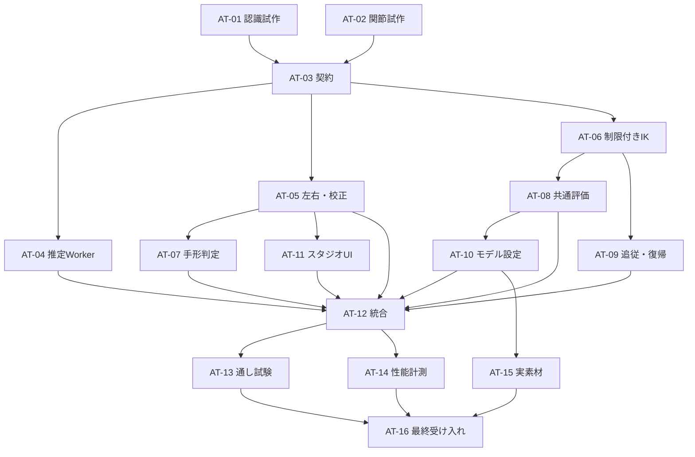

# 腕・手のトラッキング 実装計画

2026-10-31 CO。[設計書](../arm-tracking-design.md)を、担当を分けて着手できる16枚のカードにした計画。同日、ユーザーが推奨分担での実装開始を指示。**AT-01〜09・11は独立確認に合格。CO担当のAT-10はCL指摘2件を修正したCO v2の再確認待ち。CLへ修正版とAT-12統合の開始条件を連絡済み。各カード・報告・manifestを正本とする。** 製品への統合と実モデルの変更は後続カードで行う。

初版は、左右の肩・肘・手首、固定した掌面、パー・グー・指さし・ピース、顔より前の手、自然なロストと復帰を含む。分割した腕を対象にし、1枚腕の関節ワープ／スキニング、全身追従、掌と甲の切替は含めない。

## 担当と最初の着手

既存リポジトリの呼称に合わせ、**CL＝Claude Code、CO＝Codex**とし、ユーザーの指示でこの分担を採用する。各カードの「担当者・開始日」は実際の着手時に記入する。別の担当者へ渡す場合も同じ変更範囲と入出力を守る。

| 推奨担当 | 主に担当するもの                                     | 主なカード                            |
| -------- | ---------------------------------------------------- | ------------------------------------- |
| CL       | カメラ・認識・左右・手形・校正UI・スタジオ統合・性能 | AT-01・04・05・07・09・11・12・14・16 |
| CO       | 技術見本・保存契約・IK・共通変形・モデル設定・実素材 | AT-02・03・06・08・10・13・15         |

**実装を始める際の最初の2枚は [AT-01](cards/01-inference-spike.md) と [AT-02](cards/02-rig-prototype.md)。互いに独立して進められる。** 認識と関節の試作結果を受け、AT-03で共有の契約を一度確定する。必要な実機結果がない場合は、性能や方式のゲートを通過したことにしない。

実装者と独立テスト・確認者は原則別とする。一人で代行するときは実装済み／独立確認待ちを区別し、存在しない相手の確認を記録しない。過去のCL→CO引継ぎを、この新計画の独立確認の実施記録として流用しない。

## カード一覧

依存欄は**すべて必要な直接依存**。推移的な依存も含めて順序を守る。担当変更・状態変更はこの表とカードの両方へ反映する。

| カード                                       | 作業                                     | 実装 | 独立確認 | 直接依存                                        | 状態                   |
| -------------------------------------------- | ---------------------------------------- | ---- | -------- | ----------------------------------------------- | ---------------------- |
| [AT-01](cards/01-inference-spike.md)         | 顔・腕・手の同時認識と実機性能の試作     | CL   | CO       | なし                                            | 完了（条件付き採用）   |
| [AT-02](cards/02-rig-prototype.md)           | 分割腕・固定掌面の見本と関節の試作       | CO   | CL       | なし                                            | 完了                   |
| [AT-03](cards/03-contracts.md)               | 観測・リグ・設定の契約と保存互換性       | CO   | CL       | AT-01・AT-02                                    | 完了（独立確認合格）   |
| [AT-04](cards/04-capture-worker.md)          | 共有カメラ・推定Worker・モデル同梱       | CL   | CO       | AT-03                                           | 完了（独立確認合格）   |
| [AT-05](cards/05-observation-association.md) | 観測の正規化・演者と左右の対応付け       | CL   | CO       | AT-03                                           | 完了（独立確認合格）   |
| [AT-06](cards/06-constrained-ik.md)          | 制限付きIKと関節の静的制約               | CO   | CL       | AT-03                                           | 完了（独立確認合格）   |
| [AT-07](cards/07-hand-shapes.md)             | 4種類の手形判定と切替の安定化            | CL   | CO       | AT-05                                           | 完了（独立確認合格）   |
| [AT-08](cards/08-rig-evaluation.md)          | 共通の関節評価・手形表示・描画順         | CO   | CL       | AT-06                                           | 完了（独立確認合格）   |
| [AT-09](cards/09-motion-session.md)          | モデルへの追従・平滑化・ロストと復帰     | CL   | CO       | AT-06                                           | 完了（独立確認合格）   |
| [AT-10](cards/10-modeling-setup.md)          | 腕のセットアップとモデリング画面         | CO   | CL       | AT-08                                           | CL再確認 合格（CO v2） |
| [AT-11](cards/11-studio-ui-calibration.md)   | スタジオの腕設定・校正・診断画面         | CL   | CO       | AT-05                                           | 完了（独立確認合格）   |
| [AT-12](cards/12-runtime-integration.md)     | 顔・腕・手と既存スタジオの統合           | CL   | CO       | AT-04・AT-05・AT-07・AT-08・AT-09・AT-10・AT-11 | 設計の判断待ち         |
| [AT-13](cards/13-regression-e2e.md)          | 保存互換性・異常系・通し操作の回帰試験   | CO   | CL       | AT-12                                           | 未着手                 |
| [AT-14](cards/14-performance.md)             | OBS同時性能・軽量モード・長時間安定性    | CL   | CO       | AT-12                                           | 未着手                 |
| [AT-15](cards/15-character-model.md)         | 実キャラクターの腕素材と関節の調整       | CO   | CL       | AT-10                                           | 未着手                 |
| [AT-16](cards/16-acceptance.md)              | 実カメラでの自然さ・操作・初版の受け入れ | CL   | CO       | AT-13・AT-14・AT-15                             | 未着手                 |

## 依存関係

AT-04とAT-05、AT-06は契約確定後に並行開発できる。AT-08とAT-09もAT-06後に別のフォルダで進められる。AT-11は仮サービスで作るので、実カメラ接続の完了を待たない。AT-15の実素材はモデル設定UIの完了後に準備し、AT-12の統合とは並行できる。

AT-13とAT-14は同じ検証版を使う。試験の準備や集計は並行できるが、実アプリ・e2e・カメラ・OBSを使う操作はmain.lockで直列にする。共有exportファイルも短時間ずつ直列編集する。

## 2人で進める順の例

この表は実装主体の目安。相手の独立テストとレビューを各カードの区切りに挟む。日数を未測定のまま約束する工程表にはしない。

| 順  | CL                                     | CO                                     | 次へ進む条件                           |
| --- | -------------------------------------- | -------------------------------------- | -------------------------------------- |
| 1   | AT-01 認識・性能の試作                 | AT-02 関節と手の見本                   | 実行方式とリグ方式の根拠が揃う         |
| 2   | AT-03の独立テスト・契約レビュー        | AT-03 契約・移行                       | 型と保存形式、責任分担を確定           |
| 3   | AT-04 推定Worker → AT-05 左右・校正    | AT-06 IK → AT-08 共通評価 → AT-09 追従 | カメラなし／仮観測で部品が検証できる   |
| 4   | AT-07 手形 → AT-11 スタジオUI          | AT-10 モデル設定                       | 統合の直接依存を全て確認               |
| 5   | AT-12 統合                             | AT-15 実素材（対象・元画像の確認後）   | 検証対象の版とモデルを固定             |
| 6   | AT-14 性能・長時間                     | AT-13 回帰・通し操作                   | アプリ操作の時間を分け、結果を相互照合 |
| 7   | AT-16 実機・操作・受け入れの取りまとめ | AT-16の独立確認                        | 自然さ・機能・性能の未達を解消         |

担当を増やす場合は、AT-04／05／06、AT-08／09、AT-10／11を割り当てやすい。契約AT-03と統合AT-12は責任者を1人にし、共通ファイルを複数人で同時に直さない。

## 入出力と処理の所有

後続カードが同じ処理を別実装しないための境界。正式な型と関数名はAT-03の報告で確定する。

| 処理                                               | 所有カード | 次へ渡すもの                                    |
| -------------------------------------------------- | ---------- | ----------------------------------------------- |
| カメラ・モデル・Worker・撮影時刻                   | AT-04      | 顔とは独立したBodyTrackingFrame、診断と機能状態 |
| 本人・左右の対応、縦横比、ミラー、演者校正         | AT-05      | 左右対応済みの正規化観測と部位別有効性          |
| 指の伸展、手形候補、約120msの確定待ち、掌軸        | AT-07      | 確定手形と元の観測時刻、掌軸とその有効性        |
| 骨長・固定の曲がる側・IK・静的制約                 | AT-06      | 制約内の姿勢と制限理由                          |
| モデルへの写像・平滑化・腕／手首／手形の長期ロスト | AT-09      | 左右のパラメータと追従状態                      |
| 合成後の最終制約・関節差分・1種類の手形表示        | AT-08      | 共通の変形評価結果                              |
| 関節・素材・可動域・描画順の保存操作               | AT-10      | ProjectのArmRigと明示的な編集コマンド           |
| 校正の操作・設定・状態表示                         | AT-11      | 契約に沿った操作要求                            |
| producer・既存入力との優先順位・寿命・永続化の接続 | AT-12      | スタジオで動く一連の機能                        |

AT-05の左右対応とAT-07の形判定は認識側に置き、モデルの長さを参照しない。AT-09は正規化済みの観測を受け、trackingパッケージをimportしない。AT-12だけが両者を組み合わせる。AT-08の最終制約は、表情・アニメーションが値を上書きした後にも効く。

## 共有ファイルと変更の所有

| ファイル／対象                                 | 編集するカード                            | 直列化の規則                                               |
| ---------------------------------------------- | ----------------------------------------- | ---------------------------------------------------------- |
| packages/schema/**・contracts/**、契約変更記録 | AT-03                                     | 他のSTEP4契約作業とも同時編集しない。追加変更はAT-03を再開 |
| packages/ioの参照修復・保存形式                | AT-03                                     | AT-13は回帰試験で確認する。修正はAT-03へ戻す               |
| trackingのsource/**、モデル、Vite同梱設定      | AT-04                                     | 顔関連のカード71・88が実作業中なら所有を調整               |
| trackingのbody/**                              | AT-05                                     | AT-04と別フォルダ                                          |
| trackingのhands/**                             | AT-07                                     | 推定器本体はsource/body/へ置き、左右対応はbody/へ置く      |
| coreのjoint/math/・evaluate/・tracking/        | AT-06・08・09がそれぞれ所有               | 同じjoint/でもサブフォルダで分離                           |
| coreのeval・deform・hairDynamics等の腕適用     | AT-08                                     | 他の変形／物理の変更とも直列化                             |
| coreのsetup/arms/・モデリングarms/             | AT-10                                     | AT-08は設定の保存操作を実装しない                          |
| スタジオarms/                                  | AT-11                                     | runtime・servicesとの配線はAT-12                           |
| services.ts・runtime.ts・環境設定の配線        | AT-12                                     | 他のスタジオ統合作業と同時編集しない                       |
| packages/*/src/index.ts 等の公開export         | そのAPIの担当カード                       | export行のみ。編集前に使用者を確認し、1人ずつ取り込む      |
| モードの登録行                                 | モデリングはAT-10、スタジオはAT-12        | 同じ登録ファイルになった場合もAT-10→AT-12                  |
| package.json・pnpm-lock.yaml                   | 依存更新はAT-04、fixtureのscriptのみAT-08 | 更新を直列で行い、依存変更を引き継ぐ                       |
| fixtureと技術見本                              | AT-02→AT-08                               | AT-02のprototypeとAT-08の正式fixtureを分離                 |
| ユーザーの制作モデル                           | AT-15                                     | model-authoring手順、保存終了とバックアップ                |
| e2e／ユースケース、計測                        | AT-13／14                                 | 専用ファイルを分け、共通ハーネスは交代で編集               |
| この一覧・status等                             | 各担当／最終まとめAT-16                   | 書く直前に読み直し、自分の行と必要な追記だけ               |

変更範囲外の不具合は担当カードを再開して直す。所有の変更が必要なら一覧・依存・カードを先に更新する。ユーザーの判断が必要ない通常の実装調整まで、追加の承認待ちにしない。範囲や完成条件そのものを変更するときは理由を記録し、必要な判断を求める。

同じ作業フォルダでは他担当の変更を消さず、ブランチの切替・stash・reset・cleanを行わない。コミット時は対象パスだけを指定し、無関係な変更を含めない。引継ぎではカードID、コミット、公開API、実行結果、未確認点を渡す。

## 確認方法と共通の完了条件

- 各カードは実装担当と相手の独立確認を分ける。独立試験のファイル名は `*.at01.test.ts`、`*.at10.test.tsx`、`*.at13.e2e.ts` のようにする。相手の期待値を実装に合わせて書き換えない。
- 入出力・境界条件・回帰・意味のある異常系を試験する。単なる実装の写しや、低影響の文言変更だけのためのテストは増やさない。
- 型・lint・整形と変更範囲の試験を各カードで通す。AT-03では全体の型互換性、AT-13では全体の回帰・ビルド・e2eを確認する。修正が入った箇所に応じて必要な再検証をする。
- 画面は1440×1000・800×600、数値は点列の再生、自然さは連続動画で確認する。手の左右、掌面、継ぎ目、顔の前後を別項目にする。
- 性能はAT-14、実カメラの動作と自然さはAT-16。仮入力の成功を実機の成功とは扱わない。通常モードと軽量モードの結果を分ける。
- 開発サーバー・アプリ更新・e2e・実機計測前に `.cache/locks/main.lock` を排他的に取得し、担当・カード・時刻を残す。使用中なら待ち、他人のロックを勝手に消さない。起動中のユーザーのアプリを断りなく閉じない。終了時は自分のロックだけ解放する。
- 実素材の生成・配置・差替えは [model-authoring手順](../../tools/model-authoring/README.md)を使用する。毎回元画像を添付して生成し、切抜きをパーツにせず、全パーツをグリッドで確認する。編集済みモデルを組み立て直さない。
- コマンドの環境は [開発ガイド](../dev-guide.md)、既存のテスト運用は [STEP3の共通ルール](../step3/README.md)を参照する。新しい試験用ランタイムを一式追加せず、既存Vitest・e2e・計測を拡張する。

### 状態と引継ぎ

状態は「未着手 → 実装中 → 実装済・独立確認待ち → 完了」を基本にする。実機や素材が不足している場合は「実機待ち」「素材待ち」、不具合が戻った場合は「再開」と理由を記載する。これはカード管理上の状態であり、Codexの自動実行やゴールを開始するものではない。

依存カードの「完了」は必要な確認と成果物が揃い、引継ぎ可能な版が特定された状態。未完了の部品でもAT-03の契約で仮入力による独立開発はできるが、依存を省略して統合・性能・最終受け入れを完了扱いにしない。

各カードの作業記録に、担当・使用した依存の版・変更範囲・試験結果・証跡・未確認・独立確認者を残す。報告書は `docs/arm-tracking/reports/AT-XX-*.md`、証跡はカード専用のディレクトリへ置く。計画時点では空の成功報告書を作らない。

## 旧カードとの関係

腕機能の新しい詳細計画はこのAT系列を正とし、旧STEP4の未実装機能全体を技術的な待ち条件にしない。既存の共有ファイルの所有と進行中の作業は確認する。今回の計画作成で、STEP3の受け入れや他カードを完了扱いにはしない。

| 旧カード                 | 今回の対応                                   | 残す範囲                                                              |
| ------------------------ | -------------------------------------------- | --------------------------------------------------------------------- |
| 73 範囲                  | 腕・手については今回の依頼と設計で具体化     | 他の候補の判断は変更しない                                            |
| 74 複雑な見本            | AT-02の技術見本→AT-08のfixture→AT-15の実素材 | 複雑な全体基準モデルの完成は別                                        |
| 75 実カメラ・77 技術試作 | 腕分をAT-01・14・16で実施                    | 顔の他の表情・MIDI等は対象外                                          |
| 76 関節比較              | 分割腕の初版をAT-02・06・08で実施            | 1枚腕を含む3方式比較は未完了のまま                                    |
| 79 入力・82 関節の契約   | 腕に必要な範囲をAT-03で直列に実施            | 他の顔・舌・共有機能の契約は変更しない                                |
| 89 関節操作              | 分割腕の設定をAT-10で実施                    | 1枚腕、汎用スキニングは別                                             |
| 95 腕追従                | AT-01〜16へ具体化                            | 旧ArmL/Rだけの試作を今回の完成としない                                |
| 71 顔Worker・88 表情入力 | 必須の機能依存にはしない                     | AT-01で必要性が判明したら範囲と依存を更新。実作業中のsource競合は調整 |
| 97 STEP4受け入れ         | AT-16の腕機能結果を引き渡す                  | STEP4全体の受け入れ完了とは区別                                       |

## 担当へ渡すときの文面

カードのリンクと、次の情報だけで担当を始められるようにする。相手への送信・新しいチャットの作成は、この計画を作っただけでは行わない。

> AT-XXを担当してください。docs/arm-tracking/README.md と対象カード、元の設計書を読んでください。依存カードの版は［コミット等］です。カードの変更範囲で実装し、共有ファイルの所有とmain.lockを守ってください。独立確認担当は［担当者］です。完了時には変更範囲、試験結果、証跡、未確認事項と引継ぎ版をカードへ記録してください。

### COの受け渡し（2026-11-01）

AT-03の指摘修正と追加契約、AT-06（IK）、AT-08（共通評価）、AT-10（モデリング設定）は実装済み。各報告とmanifestを参照。CL独立確認待ち。AT-09は実IKを注入したCO独立試験3件が成功し、残りの独立確認は継続する。
