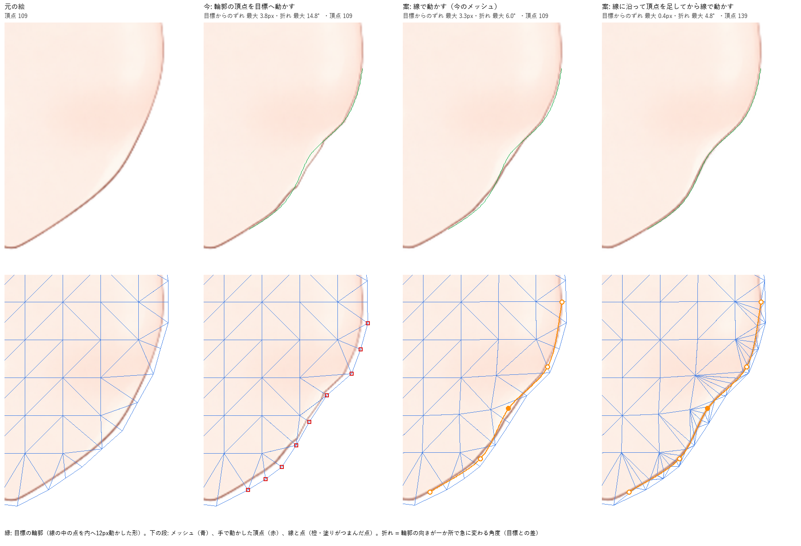

# 輪郭線で形を整える（設計）

2026-10-11 CL。ユーザーの要望（課題は I-068）。末尾の「決めたこと」で設計を確定した（同日、推奨のとおり）。実装で設計から変えた点は「実装で決めたこと」に書く。試作の画像と数値は `docs/evidence/contour-line-2026-10-11/` にある。

## 解決したいこと

ユーザーの言葉:

> 輪郭周りのメッシュを編集するとき編集点を移動させると、なめらかな曲線になってほしいのに、ｚ字のように段々になってしまう。輪郭線のような、ｚ折れしてほしくないものに、事前にラインを引いて、そのラインを編集することで、メッシュの変形ができるような機能が欲しい。流れ線編集に似た感じ？

これを、次の3つにまとめる。

1. 輪郭のように折れてほしくない所に、先に線を引いておける。
2. その線の点を動かすと、線は滑らかな曲線のまま変わり、まわりのメッシュも一緒に変形する。
3. 輪郭が段々（Z 字の折れ）にならない。

## 今の作り（コードで確かめたこと）

| 項目                       | 今の作り                                                                                                                                                                                                                                        | 問題                                                                                                                         |
| -------------------------- | ----------------------------------------------------------------------------------------------------------------------------------------------------------------------------------------------------------------------------------------------- | ---------------------------------------------------------------------------------------------------------------------------- |
| 頂点の移動（メッシュ編集） | 選んだ頂点だけを同じ量動かす。まわりの頂点は動かない（`mesh/meshTool.ts` の `startVertexDrag`）。基準状態なら基準の頂点、パラメータの編集中ならそのキーの差分に記録する（`services/keyEditor/points.ts`）                                       | 輪郭の頂点を1つずつ動かしても、隣や内側の頂点は残る                                                                          |
| メッシュの細かさ           | 自動生成の「細かい」では、内側の格子は 28px 間隔。外周の頂点は、不透明な所を 3px 広げた縁に置く（`core/src/mesh/generator.ts`）。モデルの顔は頂点 109・三角形 170                                                                               | 輪郭の絵は、外周の頂点と内側の頂点を結ぶ三角形の中を通る。三角形の中は直線で補間されるので、三角形の境目で輪郭の向きが変わる |
| 流れ線（線で曲げる）       | 髪の画像パーツ1枚に1本、根元・中間・毛先の3点。根元は頭について回り、重力・揺れと一緒に再生中に計算する。子パーツを持つ画像は対象にできない。［キーに記録］すると線は元の形に戻る（`curveGuide/curveTool.ts`、`core/src/deform/curveGuide.ts`） | 輪郭のように、何本も・何点も・キーごとに整える使い方には向かない                                                             |
| ワープ                     | 格子のマスの中を双線形で補間する（`core/src/deform/warp.ts`）                                                                                                                                                                                   | 制御点を動かすと、マスの境目で折れる（今回の範囲の外）                                                                       |

## なぜ段々になるか（試作で確かめたこと）

モデル（`projects/cardigan-bob-20261010`）の顔のパーツで比べた。画面右のあごの輪郭に5点の線を置き、真ん中の点を内へ 12px 動かした形を目標にした。比べたのは基準状態だが、キーの値でも同じ計算になる。



| やり方                                          | 目標の輪郭からのずれ（最大・平均） | 折れ（最大） | 頂点 |
| ----------------------------------------------- | ---------------------------------- | ------------ | ---- |
| 今: 輪郭の頂点だけを、目標の位置へ1つずつ動かす | 3.8px・1.1px                       | 14.8°        | 109  |
| 案: 線で動かす（今のメッシュのまま）            | 3.3px・1.2px                       | 6.0°         | 109  |
| 案: 線に沿って頂点を足してから、線で動かす      | 0.4px・0.16px                      | 4.8°         | 139  |

「折れ」は、輪郭の向きが一か所で急に変わる角度（目標の曲線との差）。2px ごとの向きで測った。ずれと折れは描き直した画像からではなく、三角形の補間から直接求めた。

分かったこと:

- 段々の原因は、輪郭の頂点だけが動いて、内側の頂点が残ること。輪郭の絵は両方を結ぶ三角形の中にあるので、三角形ごとに引っぱられ方が変わり、境目で折れる（最大 14.8°）。目標の位置へ頂点を正確に置いても、輪郭は目標から最大 3.8px ずれる。
- 線で動かすと、内側の頂点も線からの距離に応じて滑らかについてくるので、折れは 6.0° に減る。ただ、今のメッシュ（28px 間隔）では三角形より細かい曲がりを出せないので、ずれは 3.3px 残る。影響幅を広げても、このずれは減らなかった。
- 線の上に 6px ごとに頂点を足すと、ずれ 0.4px・折れ 4.8° で、狙った曲線になる。頂点を足しただけ（動かす前）では、絵は変わらない（画素の差は最大 0.006。色の値を 0〜1 としたとき）。外周の頂点は残した。
- 足す頂点は、線の上の1列で足りた。線の内側にもう1列足しても、輪郭の結果は変わらなかった。

再現: `projects/cardigan-bob-20261010/authoring/contour_proto.py`（モデルのフォルダは Git の管理外）。数値は `docs/evidence/contour-line-2026-10-11/metrics.json`。

## 考え方

1. **線は絵の上に引く。** 線の点は「素材の画像の中の位置」で覚える。キーで形が変わっても、メッシュを作り直しても、線は絵の同じ所について動く。
2. **線は形を整える道具で、動きはキーに入る。** 線の点を動かした結果は、頂点の移動と同じく、基準状態なら基準の頂点、パラメータの編集中ならそのキーに記録する。再生中・スタジオ・出力では線を計算しないので、描画・物理・出力は変わらない（D3）。
3. **線は点を通る滑らかな曲線。** 点を動かしても、線は滑らかなまま変わる。変わるのは、その点の近くの区間（両側に2区間ずつ）だけ。
4. **線の近くの頂点は線と同じだけ動き、離れるほど弱まる。** 影響幅の所で動きは 0 になる。
5. **一緒に動かすパーツを選べる。** 輪郭の線画や頬のように重なったパーツにも同じ動きを使うので、絵がずれない（D5）。
6. **線に沿って頂点を足せる。** 足すと、輪郭が線どおりの曲線になる（D4）。

### 流れ線との違い

操作は流れ線に似ている（線を引いて、少ない点を動かす）。ただ、目的と動きが違うので、別のツールにする（D2）。

| 項目     | 流れ線（線で曲げる）                                                       | 輪郭線（今回）                                         |
| -------- | -------------------------------------------------------------------------- | ------------------------------------------------------ |
| 目的     | 髪を曲げる・重力で垂らす・揺らす                                           | 輪郭のように折れてほしくない線の形を整える             |
| 本数と点 | 1パーツに1本、3点（根元・中間・毛先）                                      | 1パーツに何本でも、2点以上（足せる・消せる）           |
| 端       | 根元は頭について固定                                                       | 両端も動かせる                                         |
| 結果     | 再生中に毎回計算する（重力・揺れ）。記録するとキーに入り、線は元の形に戻る | 動かすたびに今のキーに入る。線は絵についたまま残る     |
| 対象     | 子パーツの無い髪の画像1枚                                                  | 画像パーツ1枚と、一緒に動かすパーツ                    |
| 置き場所 | ツール「線で曲げる」、パレット「流れ線」                                   | ツール「輪郭線で整える」、パレット「輪郭線」（D1・D2） |

部品は使い回す。表示の位置から各頂点の局所座標への逆算（`mesh/meshDrag.ts` の `createMeshTargetMapper`）、キーへの記録と「この値にキーを追加して編集しますか？」の確認（`canvas/liveEdit.ts` の `startKeyedDrag` と `pointsEdit`）、三角形の裏返りの確かめ方は、流れ線の［キーに記録］と同じ。

## 操作

### 流れ

1. ツールバーの［輪郭線で整える］を選び、キャンバスで画像パーツをクリックする。選ぶ段は、メッシュ・ワープ・流れ線と同じ（帯の案内と点線の囲み）。メッシュが無ければ、パレットが「先にメッシュを自動生成してください」と出す。
2. パレットの［線を引く］を押し、輪郭をなぞる（ドラッグ）。点を順にクリックしてもよい（ダブルクリックか Enter で終わり、Esc でやめる）。なぞった線からは、点を自動で置く（約 50px ごと、最低3点）。
3. パレットの［線に沿って頂点を足す］を押す（D4）。キーがあれば、今の頂点の追加と同じく「変形を新しいメッシュへ移します」と確認する。
4. 編集するパラメータの値にして（例: 顔の左右を +30）、線の点をドラッグする。線は滑らかなまま曲がり、輪郭と、まわりの絵がついてくる。
5. 点が足りなければ、線をダブルクリックして足す。要らない点は選んで Delete。
6. 前に頂点で動かして段々になったキーでは、［線に合わせて整える］を押す。輪郭が、線の点を通る滑らかな形にそろう。

流れ線を有効にしているパーツは対象にしない（パレットで知らせる）。流れ線は再生中に形を変えるので、見えている線と記録する形が合わなくなるため。

### キャンバスの操作

| 操作                      | 何が起きるか                                                                                                              |
| ------------------------- | ------------------------------------------------------------------------------------------------------------------------- |
| 点のドラッグ              | その点を動かし、線とまわりのメッシュを変形する。今のキーに記録する（キーが無ければ追加を確認）。1回のドラッグで1回の Undo |
| 線の上のドラッグ          | 点の無い所をつまむと、そこに点を足してから動かす                                                                          |
| Shift+クリック            | 点を選び足す。選んだ点のどれかをドラッグすると、まとめて動く                                                              |
| Alt+ドラッグ              | 形は変えずに、線の点だけを動かす（絵の上での線の位置を直す）                                                              |
| 線のクリック              | その線を選ぶ（パレットの影響幅などの対象になる）                                                                          |
| 線のダブルクリック        | そこに点を足す（形は変わらない）                                                                                          |
| Delete                    | 選んだ点を消す（形は変わらない。2点より少なくはできない）                                                                 |
| 何も無い所のクリック・Esc | 1回目は点の選択を外し、2回目でパーツの選択を外す（メッシュ・ワープと同じ）                                                |
| 右クリック                | パーツの選択を外し、選ぶ段に戻る                                                                                          |

頂点の移動と同じ規則で止める: プレビュー中（キーを編集していないパラメータの値がデフォルトでない間）は動かさずに知らせる。逆算できないとき・三角形が裏返る手前では、そこで止めて知らせる。

### 見た目

右の列のいちばん上に、オブジェクトパレット（ツール）として出す。

```
▌▾ 輪郭線                         ツール  ⓘ
  対象: 顔
  線: [あご 右 ▼]   [線を引く] [消す]
  影響幅  ────●──────  48px
  一緒に動かすパーツ:  ☑ 輪郭の線画   ☐ 頬
  [線に沿って頂点を足す]
    線の近くの頂点の間隔 28px（粗い。足すと輪郭が線どおりになる）
  [線に合わせて整える]（今のキー）
  点 5・選んだ点 1
```

- キャンバス: 選んだ線は太い橙、点は白い丸（選んだ点は塗る）、影響幅は線のまわりの薄い帯。同じパーツのほかの線は細く出す。
- 線はどのキーでも、その姿勢のメッシュを通して描く。段々が残っているキーでは、線にも段々が見える（直す所が分かる）。
- ⓘ の説明:
  - 目的: 輪郭のように折れてほしくない所に線を引き、線の点を動かしてメッシュを滑らかに変形する。動きは今のキー（基準状態なら基準の形）に記録する。
  - 流れ: 1. キャンバスでパーツをクリック 2. ［線を引く］で輪郭をなぞる 3. ［線に沿って頂点を足す］ 4. パラメータの値を選び、点をドラッグ 5. 段々が残っているキーは［線に合わせて整える］

## 動かし方の計算

1. **線の形**: 点を通る滑らかな曲線（Catmull-Rom 曲線）。区間ごとの曲がり方の割合は、点を置いたときの間隔で決めて固定する。そのため線は点の位置の足し算で表せ、1つの点を動かしても、変わるのはその点の両側2区間ずつ（全部で4区間）だけになる。
2. **線の動き**: つまんだ点を Δ 動かすと、線の上の各位置は「その位置での点の効き具合 × Δ」だけ動く。
3. **頂点の動き**: 各頂点について、線の上の各位置の動きを、近い所ほど強く混ぜる（重みは距離の2乗に反比例）。線の真上では線の動きと一致し、離れるほど広い範囲の平均になる。これに、線からの距離による弱め方を掛ける（影響幅の 1/4 までは 1、影響幅で 0、その間は滑らかに下げる）。あごの内側のように曲がった線の内側でも、いちばん近い位置が途中で飛び移らないので、動きが途切れない。
4. **記録**: 計算は今の姿勢の表示の位置で行う。各頂点の目標の位置から、自身の変形・親のワープ・親の変形を逆算して局所座標の差分にし、今のキーに記録する。一緒に動かすパーツも同じ動きを使い、まとめて1つの Undo にする。
5. **つまんだ点**: マウスの下に来るように、動かす量を合わせる。
6. **破綻の防止**: 三角形が裏返る・潰れる手前で止め、知らせる。
7. **速さ**: 押したときに、頂点ごとの効き具合を1回だけ計算する。動かす間は、掛け算と逆算だけ。

影響幅の既定は、線の長さの 1/4（16〜120px）。試作の線（長さ約 200px）では 48px。

**線に沿って頂点を足す**:

- 線の上に 6px ごと（キャンバスの px）に頂点を足し、三角形を作り直す。メッシュの外周の頂点は消さない。新しい頂点から 3px 以内にある内側の頂点だけを除く。
- 新しい頂点の UV は、元の三角形の中の位置から決めるので、絵は変わらない。キーは今の転写（カード28 の `transferMeshKeys`）で新しい頂点へ移す。
- 手で編集したメッシュとして扱う（`edited: true`）。［自動生成］で作り直すと、足した頂点は消える（線は絵についているので残る）。

**線に合わせて整える**: 今のキーで、線の点を通る滑らかな曲線と、今の線（絵についた線）の差を求め、上の 3〜6 と同じやり方で頂点へ広げて記録する。

## 保存の形（契約の変更 CC-015、schemaVersion 7）

```ts
// 輪郭線（I-068）。形を整える道具で、描画・物理・出力では使わない（形はキーの頂点の差分に入る）
export interface ContourLine {
  id: Id;
  partId: Id; // 線を引いた画像パーツ。線はこのパーツの画像の上につく
  name: string; // パレットに出す名前（既定は「線 1」など）
  points: Vec2[]; // 点。素材の画像の中の位置（UV、0..1）。2個以上、線の向きの順
  radius: number; // 影響幅（キャンバスの px、4..400）
  withPartIds: Id[]; // 一緒に動かす画像パーツ（partId は含めない）
}
export interface Model {
  // …今の項目…
  contourLines?: ContourLine[]; // 省略は空。I-068 / schemaVersion 7
}
```

- 移行: 6 → 7 では何も足さない（省略は空）。古いアプリで開くと、今と同じく新しい版として断る。
- 検査: 点は2個以上の有限の数、影響幅は範囲の内、`partId` はメッシュのある画像パーツ、`withPartIds` はほかの画像パーツで重複が無いこと。
- 読み込みの修復: 対象のパーツが無い線は外し、一緒に動かすパーツから無いものを外す（流れ線と同じ形で、修復の一覧に出す）。
- パーツの削除・複製・左右反転: 削除すると、そのパーツの線も消す。複製・反転では線を写す。点は画像の上の位置なので、そのまま使える。
- PSD の再読み込みで素材の大きさや位置が変わったときは、キャンバス上で同じ位置になるように点を直す。

## 作るもの・変えるファイル

| 場所                                                                              | 中身                                                                                                                          | 担当の注意                                       |
| --------------------------------------------------------------------------------- | ----------------------------------------------------------------------------------------------------------------------------- | ------------------------------------------------ |
| `packages/schema/src/`（types・validate・migrate・defaults）                      | `ContourLine`、schemaVersion 7、検査・移行とテスト                                                                            | 契約。CO の確認の後（D9）                        |
| `packages/core/src/contourLine/`（新規）                                          | 曲線（区間の割合を固定した Catmull-Rom）、絵へのつけ方（UV → 三角形）、表示の位置、頂点の効き具合、頂点の追加、三角形の確かめ | 新規                                             |
| `apps/desktop/src/modes/modeling/contourLine/`（新規）                            | ツール（引く・なぞる・クリック、点のドラッグ・選択・追加・削除、Alt で位置だけ）、パレット、ⓘ、登録                           | 新規                                             |
| `apps/desktop/src/modes/modeling/mesh/`                                           | （D6 を足すとき）頂点の移動の「まわりも動かす」幅                                                                             | CL                                               |
| `apps/desktop/src/modes/modeling/structure/`、`packages/io/src/project/repair.ts` | 削除・複製・反転・読み込みの修復                                                                                              | 流れ線（CO）と同じ所を触る                       |
| `docs/contract-changes.md`・`docs/issues.md`・`docs/status.md`                    | CC-015、I-068、状態と使い方                                                                                                   | 書く直前に読み直す（ほかのセッションの書きかけ） |

## テストと確認

- 単体（core）:
  - 曲線が点を通る。1つの点を動かすと、その点の両側2区間ずつの外は動かない。点の位置について足し算になっている。
  - 頂点の動きが、線の上で線の動きと一致し（1e-6 以内）、影響幅の外で 0 になる。U 字の線の内側でも途切れない（隣り合う頂点の動きの差が一定以下）。
  - 頂点を足す前後で、動かす前の絵が変わらない（画素の差が 0.01 以下。試作では 0.006）。外周の頂点が残る。キーが新しい頂点へ移る。
  - 三角形が裏返る手前で止まる。
- 単体（アプリ）:
  - 線を引くと、画像の上の位置で保存される。キーを変えても、メッシュを作り直しても、絵の同じ所に出る。
  - 基準状態では基準の頂点、キーの値ではそのキーが変わる。キーが無ければ追加を確認する。1回のドラッグで1回の Undo、ドラッグ中の Esc で取り消し。
  - プレビュー中は動かさずに知らせる（頂点の移動と同じ）。
  - 一緒に動かすパーツも同じだけ動く（線の上でのずれが 0.5px 以内）。
  - Alt+ドラッグ、点の追加・削除では形が変わらない。
  - パーツの削除・複製・反転、保存と再読み込みで、線が正しく残る。v6 のプロジェクトが開ける。
- 試作と同じ条件: モデルの顔の輪郭で、線に沿って頂点を足してから真ん中の点を 12px 動かす → 目標からのずれ 0.5px 以内、折れ 6° 以内。
- 全体: `pnpm test`・`pnpm typecheck`・`pnpm lint`・`pnpm format:check`。
- 画面: 開発サーバーで 1440×1000 と 800×600。線を引いた状態、点をつまんだ状態、パレット、ⓘ を画像に残す。

## 完成の条件

- 顔の輪郭に線を引き、点を動かすと、輪郭が段々にならず滑らかに曲がる（上の数値を満たす）。
- 基準状態でも、パラメータのキー（顔の左右 ±30 など）でも使え、今のキーに記録される。1回の Undo で戻る。
- 線はどのキーでも絵の同じ所に出る。メッシュを作り直しても残る。
- 一緒に動かすパーツが、線を引いたパーツとずれない。
- 保存して開き直しても線が残る。v6 のプロジェクトが開ける。
- スタジオ・出力・物理の動きは変わらない（変わるのはキーだけ）。

## 決めたこと（2026-10-11 ユーザー: 「推奨設定でよいです」）

| #   | 内容                                     | 決定                                                                                         |
| --- | ---------------------------------------- | -------------------------------------------------------------------------------------------- |
| D1  | 名前                                     | 「輪郭線」（ツールは「輪郭線で整える」）                                                     |
| D2  | 置き場所                                 | 新しいツールと、そのオブジェクトパレット（流れ線と並べる）                                   |
| D3  | 線の動きの扱い                           | 形を整える道具。動きはキーに記録し、再生中は計算しない                                       |
| D4  | 線に沿って頂点を足す                     | パレットのボタンで足す。線の近くの頂点が粗いときは案内を出す                                 |
| D5  | 一緒に動かすパーツ                       | 線を引いたパーツだけを既定にし、パレットで選んで足す（影響幅にかかるパーツを候補に出す）     |
| D6  | 頂点の移動に「まわりも動かす」幅を足すか | 足す（メッシュのパレットに幅。既定は 0 で今と同じ）                                          |
| D7  | なぞった線を絵の縁に吸いつけるか         | 今回は入れない（Alt+ドラッグで線の位置を直せる）                                             |
| D8  | 輪（閉じた線）                           | 今回は開いた線だけ                                                                           |
| D9  | CO との調整                              | CO が設計書を読む。CC-015 と、流れ線・パーツの構造（複製・反転・修復）のファイルを触ってよい |

## 実装で決めたこと（2026-10-11）

設計から変えた点と、設計に無かったことを決めた点。

- **頂点へ広げる重み**: 距離の2乗ではなく4乗で下げる（「受け持つ長さ ÷ (距離² + 0.01)²」）。2乗では、線の端のそばの頂点に線の遠い所の動きが入り、真ん中の点を 20px 動かすと端のそばが 0.8px 動いた。4乗では 0.2px ほどで、これは曲線そのものが端の区間で少し逆へ動く分（点を通る曲線の性質）。
- **線のすぐそばの頂点を直す**: 線から 3px 以内の頂点は、線が目標の動きになるように最小二乗で直す（`fitLineMotion`）。線の上の頂点が線から少しずれている所でも、線が目標に届く。離れた頂点まで直すと、粗いメッシュで動きが波打った（線から 10px の頂点が線と 2.8px 違う動きになった）ので、3px 以内に限った。
- **［線に沿って頂点を足す］は今の頂点を消さない**（設計では、新しい頂点から 3px 以内の内側の頂点を除くとしていた）。今の辺をすべて制約にして三角形を分けるので、新しい三角形はどれも元の三角形の中に収まる。そのため絵の位置（UV）とキーの補間は、頂点を動かしたメッシュでも、キーのある姿勢でも、元とまったく同じになる。今の頂点を消すと、そこで補間が変わり、頂点を動かしたメッシュで絵が 0.9px ずれた。そのうえで:
  - 線が今の辺と交わる所にも頂点を置き、線に沿った頂点を辺でつなぐ。線はどこでも、線の上の頂点を結んだ辺を通る（交わる所に頂点が無いと、そこでは線から 10px 離れた頂点だけで線の位置が決まり、整えても 2.6px のずれが残った）。
  - 今の頂点から 3px 以内では、その頂点を使う。内側の辺から 1.5px 以内の点は辺の上へ寄せる（とても細い三角形を作らない）。外周の辺から 1px 以内には置かない。
- **［線に合わせて整える］**: 目標（今の点を通る滑らかな曲線）を最初に決めて固定し、2回くり返す。頂点を動かすと点も一緒に動くため。三角形が裏返るときは、裏返らない所まで弱めて知らせる（ドラッグと同じ）。試験の格子（20px のマス）で、頂点を1つ 8px 動かして作った段（最大 3.5px）は、今のメッシュのままでは 2.3px まで、線に沿って頂点を足してからは 0.15px まで減った。
- **一緒に動かすパーツ**: 線の目標の動きを広げて動かす。最小二乗で直すのは線を引いたパーツだけなので、線の上で両者がずれるのは、その直した分だけ（試験の格子では 0）。
- **線の色**: メッシュの線（アクセントの色）と見分けるため、決まった橙（#f08c2e）にした。
- **線の上を押したとき**: すぐ離すとその線を選ぶ。押したまま動かすと、そこに点を足して動かす（点の追加と変形で1回の Undo）。ダブルクリックは点を足すだけ。
- **Undo の名前**: 「輪郭線を引く」「輪郭線で整える」「線に合わせて整える」「線に沿って頂点を足す」「輪郭線の点の位置」「輪郭線に点を足す」「輪郭線の点を消す」「輪郭線の影響幅」「一緒に動かすパーツ」「輪郭線を消す」。
- **D6 の「まわりも動かす」**: メッシュのパレットのつまみ（0〜200px、既定 0 = オフで今と同じ）。選んだ頂点からの距離で滑らかに弱め、幅の所で 0 にする。選んだ頂点のまわりに点線の円を出す。幅はプロジェクトに保存しない（アプリを開いている間だけ覚える）。
- **PSD の再読み込み**: 大きさが変わった素材では、キャンバス上の同じ位置になるように点の UV を直す。位置だけ変わった素材は、メッシュごと動くので直さない。

## 確かめたこと（2026-10-11）

- 単体: 全体 2,601件が通った（新規 45件: schema 8・core 11・desktop 26）。型・lint・整形も通った。
- 開発サーバーの画面（1440×1000・800×600）で、モデル（`projects/cardigan-bob-20261010`）の顔を使って確かめた。実行時のエラーは無かった。
  - ［輪郭線で整える］で顔を選び、あごの輪郭に点を5つクリックして線を引いた。パレットに「線 1（点 5）」・影響幅 45px・一緒に動かすパーツの候補が出た（[画面](evidence/contour-line-2026-10-11/screen-line-1440.jpg)）。
  - ［線に沿って頂点を足す］で、顔の頂点が 109 → 140 になり、頂点のキー3本も 140 の差分になった。線の上に頂点が並ぶ（[メッシュ](evidence/contour-line-2026-10-11/screen-mesh-vertices.jpg)）。
  - 顔 左右 +30 のキーで、線の真ん中の点を内へ動かすと、線と輪郭が滑らかに曲がった（[前](evidence/contour-line-2026-10-11/screen-key30-before.jpg)・[後](evidence/contour-line-2026-10-11/screen-key30-after.jpg)）。記録先は顔 左右のキー、Undo の名前は「輪郭線で整える」。Ctrl+Z で1回で戻り、Ctrl+Y でやり直せた。
  - ⓘ の説明（[画面](evidence/contour-line-2026-10-11/screen-info-1440.jpg)）、800×600 での右の列（[画面](evidence/contour-line-2026-10-11/screen-800.jpg)）、メッシュの「まわりも動かす」40px の点線の円（[画面](evidence/contour-line-2026-10-11/screen-mesh-soft.jpg)。選んだ頂点が 4.2px、まわりの8頂点が 1.9〜0.04px 動いた）。
- 一緒に動かすパーツの候補は、顔の線だと目や口なども影響幅にかかって多くなるので、候補の欄は高さ 160px で中をスクロールする形にした。
- 未実施: インストール版のアプリでの確認、人による全手順（tests/usecase/changes.md の UC-CH-43）、保存して開き直す手操作。

## 範囲の外・関係するもの

- ワープの格子の境目で折れる問題（双線形の補間）は別の話。必要なら別の課題にする。
- 流れ線（I-063、カード99・100）の動きは変えない。逆算・キーへの記録の部品を使い回すだけ。
- 顔の左右の向き（I-067）の修正でも、輪郭を整える道具として使える。
- 左右対称の編集（片側の線を動かすと、反対側も動く）は今回は作らない。
