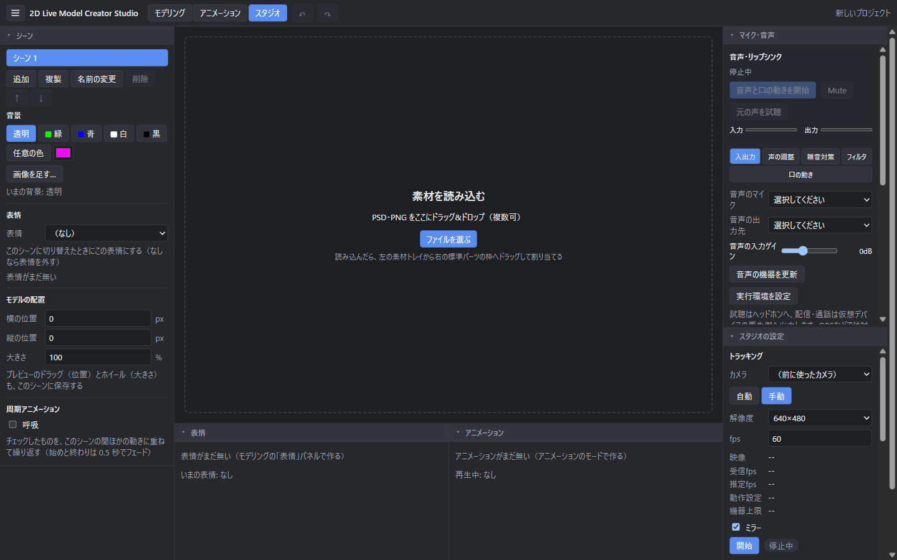
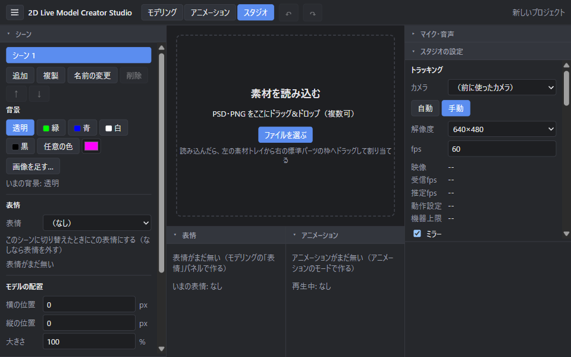
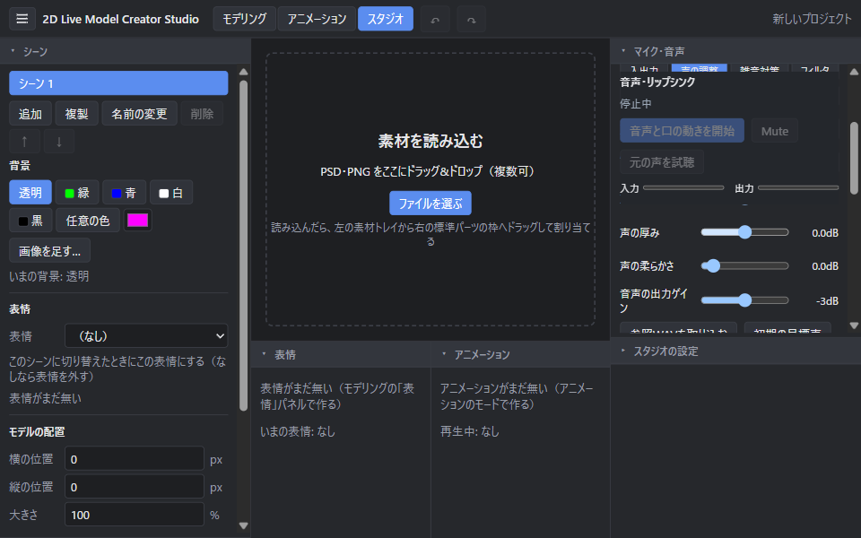

# マイク・音声パネルの独立

2026-10-14 CO。マイク回りを別パネルにする依頼に対応した。

スタジオ右側の先頭に［マイク・音声］を追加し、AI音声の入出力・声質・雑音対策・フィルタ・口の同期と、従来のマイク入力・リップシンクを移した。カメラ・キャリブレーション・体の動き・映像出力は［スタジオの設定］にある。各パネルは独立して折りたたみ、高さを変更できる。既存のパネル枠を使い、折りたたみで部品を外さないため、音声セッションは継続する。保存形式11と音声処理は変更していない。

関連する既存テストは36ファイル・290件成功。デスクトップとe2eの型検査、変更箇所のlint・整形、本番ビルドが成功した。

配置済み本番アプリを1440×900・960×600で確認した。音声とカメラ側のパネルを別々にたたみ、音声側の高さを境目のキー操作で316pxへ変更・リセットした。高さの保存先も別で、カメラ側の値は変わらない。入力4件・出力4件を読み込み、音声欄の横幅244pxに対し内容幅244px。検証用APIなし、pageerrorなし。

検証用プロセスの所有を確認してから接続し、そのアプリだけを終了した。マイク・カメラは開始せず、利用者の制作プロジェクトを開いたり変更したりしていない。本番アプリを更新し、[配置SHA256](installed-hash.json)がreleaseと一致した。[画面の検証結果](smoke.json)、[回帰テスト](tests.log)、[操作説明](../../studio-voice-guide.md)。

