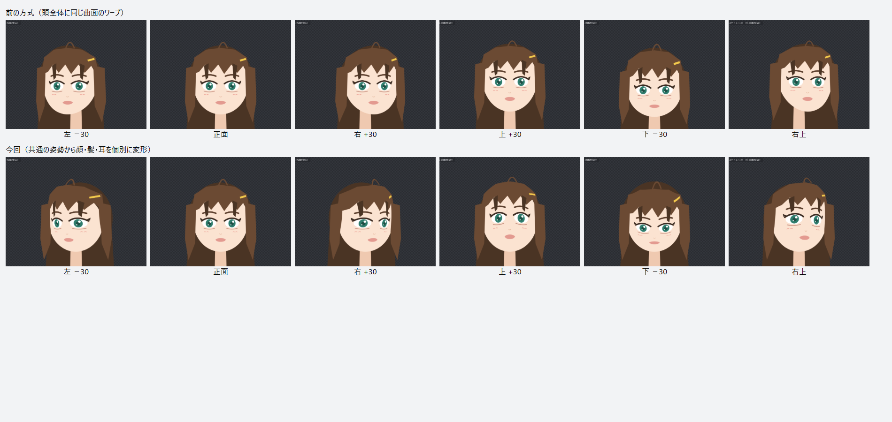

# I-039 頭の向きの作り直し（共通の姿勢から顔・髪・耳を個別に変形する。2026-10-06）

状態: 実装（試作）。基準モデルで画面を確かめ、自動テストと本物のアプリの通しのテストが通った段階。見た目の自然さはユーザーの確認待ち。
側面の補助素材・角度による前後の入れ替え（露出・遮蔽の規則）は、まだ入れていない（下の「まだのこと」）。

## 前の方式との違い

前の方式（[頭全体の曲面](i-039-head-surface-result.md)）は、頭（headRoot）に1つのワープを付け、顔・髪・耳の全部に同じ曲面の変形を掛けていた。顔が髪からずれることは無くなったが、頭全体が少し横へずれるだけで、輪郭と目鼻の位置関係が変わらず、向きが形として読み取れなかった。

今回は [追加設計](i-039-head-rotation-design.md) と [実装記録](approved-issue-implementation.md) の方針どおり、「共通の向き」と「全画像へ同じワープ」を分けた。

- 頭の向き（FaceAngleX・FaceAngleY）を1つの共通の姿勢として決め、headRoot の子孫の画像パーツの頂点を、パーツの種類ごとの層で動かす（core の `setup/headPose.ts`）。ワープは使わない。
- 頭は楕円体とみなす。寸法は顔の素材の形から求める（横の半径 = 顔の幅 / 2 × 1.05、縦はあごから顔の上端の 0.3 倍上まで）。長い髪は寸法に入れない。
- 層:
  - 顔の表面（顔・頬・目・眉・口）: 表面に沿って回す。楕円の中心ほど大きく動き、縁（輪郭）は動かない。横を向くと、目鼻口がその向きへ寄り、近い側の目は細く、遠い側の頬は広くなる。上下も同じで、あご（下端）と頭の上端は動かないので、首とのつながりが切れない。
  - 前髪（表面より少し手前。1.05 倍）・横髪（0.55 倍）: 表面と同じ回し方。外側の輪郭は動かない。
  - 後ろ髪（0.35 倍）・耳（0.25 倍）: 頭の後ろ側として、向きと逆へ平行に動く（視差）。上を向くと少し下へ。
  - 標準パーツでない画像は、いちばん近い標準の画像の祖先の層（前髪の上のアホ毛・耳のイヤリングなど）。標準の祖先が無ければ、奥行き（Part.depth）が 0 以上なら表面、負なら後ろ側。
- 角度の上限はモデルごとに求める（一律の 12度・6度にしない）。目・眉・口の頂点が、回したあと楕円の中心から 62度（上下は 55度）を超えない最大の角度。左右は 8〜25度、上下は 4〜14度に収める。基準モデルでは左右 25度・上下 14度。パラメータ ±30 がこの角度。
- 斜め（左右と上下を同時に ±30）は、それぞれ 75% の角度で回した形にする（そのまま足すと目鼻が四隅へ寄りすぎた）。
- キーは各画像パーツのメッシュの頂点の差分（source 'auto'）: 左右・上下は −30〜30 の 10 刻み、斜めは ±30 の4隅の補正（3×3 の格子）。パーツの基準の変形が恒等でなくても、headRoot の空間で求めた差分をパーツの空間へ戻して記録する。メッシュの無いパーツは、素材の矩形の 3×3 の点の動きの平均を位置のキーにする。
- 首・体・腕には掛けない。顔の傾き（FaceAngleZ）・目・口・呼吸・腕・髪の揺れの設定は変えない。

## 切り替えと保護

- アプリのかんたんセットアップは `createAutoSetup({ faceTurn: 'head-pose' })`（以前は 'head-surface'）。core の 'head-surface'・'surface'・'depth' は比較用に残す。
- 既存のモデルは、開いただけでは変えない。かんたんセットアップを押し直すと切り替わる（Undo 1回で戻る）。そのとき、それまでの方式の自動のキー（頭・顔のワープの顔の向き、旧方式の奥行きの移動）を消して、二重に掛けない。
- 頭・顔のワープの顔の向きに手で直したキー・ロックしたキーがあれば、切り替えずに警告し、それまでの設定を残す。
- 新しい方式の頂点のキーを手で直す・ロックすると、やり直しても残る。
- 保存形式（schemaVersion 3）と契約は変えていない。

## 画面の記録

基準モデル（fixtures/reference-model。メモリ上でかんたんセットアップを掛けた。ファイルは変えていない）を、開発サーバーの画面で撮った。数値はアプリのパラメータ。

- [今回の9つの向き](evidence/i039-head-pose-2026-10-06/head-pose_poses.png)・[前の方式の9つの向き](evidence/i039-head-pose-2026-10-06/head-surface_poses.png)
- 1枚ずつの画像（`head-pose_x<左右>_y<上下>.png`）と [撮影の記録](evidence/i039-head-pose-2026-10-06/poses.json)
- 撮り直すとき: 開発サーバーを動かして `node tools/dev/head-pose-capture.mjs <出力フォルダ> head-pose head-surface`

見え方の確認（撮影した画像を見て）:

- 左右: 全体の横移動を除いても、輪郭に対する目鼻口の位置で向きが分かる。近い側の目が細くなり、遠い側の頬が広くなる。後ろ髪は逆へ少し動く。
- 上下: 上で目鼻口が上がり、下で前髪が目に近づく。あごと首はつながったまま。下向きで頭の上の後ろ髪が多く見える。
- 斜め: 四隅でも目鼻口は輪郭の中に収まる。
- 気になる所: 下向きで前髪の左下の縁に小さな段差が出る。右向き 30 で遠い側の目（画面の右）がかなり細くなる。耳はこのモデルでは髪に隠れて見えない。

## 確かめたこと

- core の headPose.test.ts（9件）: ワープでなく頂点のキーで作る・基準の姿勢は変わらない・首と体には掛けない、横を向くと輪郭はほぼ動かず目鼻口が寄る（近い側の目は細くなる）、後ろ髪・耳は逆へ・前髪は同じ向きへ、上下であごが動かない、角度の上限はモデルから決まる（目を縁に寄せたモデルでは小さくなる）、斜めで目鼻口が輪郭の中、やり直しても同じ・手で直したキーが残る・Undo、前の3つの方式から切り替わって二重にならない、ワープに手で直したキーがあれば切り替えずに警告。
- desktop の services.step2.test.ts: 本物のサービスのかんたんセットアップで、ワープを作らず、目・前髪は向きへ、後ろ髪は逆へ（メッシュの無い fixture は位置のキー）。
- 本物のアプリの通しのテスト（modeling.e2e.ts）: PSD の取り込みからかんたんセットアップで、顔と前髪が向きへ、後ろ髪が逆へ動く。保存・開き直しで同じ。
- 単体テストすべて・lint・型検査。

## まだのこと（I-039 を対応済みにしない理由）

- 見た目の自然さのユーザーの確認。角度の目安（62度・55度・25度・14度）、層の倍率、斜めの 75% は試作の値で、ユーザーのモデルで調整が要るかもしれない。
- 側面・裏側の補助素材（描き足した横顔・耳の付け根など）の割り当てと、角度に応じた表示範囲・前後の入れ替え（露出・遮蔽）。いまは描いてある絵の中で動かすだけで、描かれていない側面は現れない。
- 耳が顔の前に出る向きでの描画順の入れ替え。
- 髪の揺れ（物理）と頭の向きを同時に使ったときの付け根の見え方の目視（通しのテストの物理の結合は通っている）。
- ユーザーの実際のモデル・カメラ・OBS での確認。
