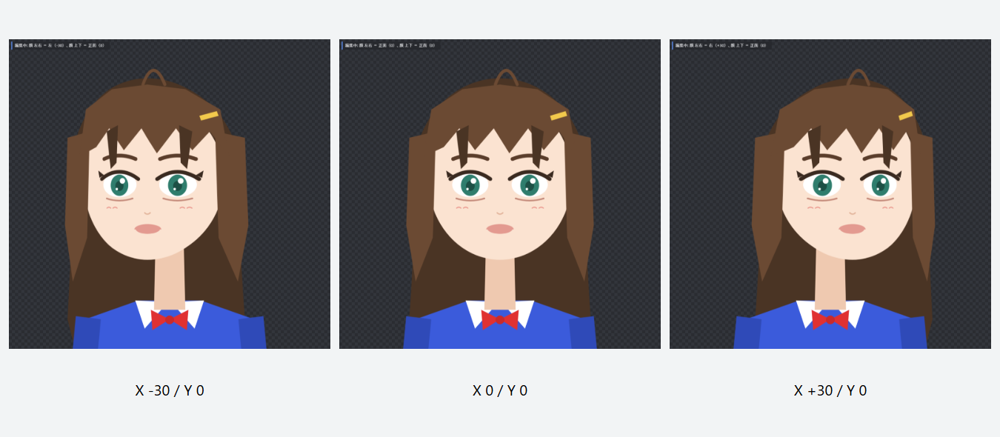

# I-039 左右の動きの修正（2026-10-05）

## 前回の問題と修正

前回は顔の曲面変形を外して髪の奥行き方式へ寄せた結果、ずれだけでなく左右を向く変化まで弱くした。画素に差があることを確認するだけでは、見て分かる動きの検証として不十分だった。

今回は **顔側の曲面変形を基準に、既存の headRoot に共通ワープを作る** 方式に修正した。顔・髪・耳・頭部の子パーツが同じワープに追従する。顔と髪の階層・描画順は変更していない。

- 顔だけに掛かっていた自動曲面キーと、旧方式の自動奥行き移動キーは除き、回転相当の変形を二重に掛けない。
- 曲面の寸法は顔グループの形を頭部の座標へ変換して求める。長い後ろ髪を半径の基準にしない。
- パラメータ ±30 に対し、曲面の左右は ±12度、上下は ±6度。上下は首との重なりを残すためさらに狭めた暫定値で、全モデルの安全範囲を保証するものではない。
- 10刻みのキーと斜めの補正を保存する。生成方式は linear とし、一般の再補間操作で旧方式の20度へ戻らないようにした。
- 旧顔ワープに手動・ロック済みキーがある場合は、自動変換せず、顔の向きの設定一式を残して警告する。壊れた頭部ワープがある場合も切り替えない。
- 頭部ワープの基準形と手動・ロック済みキー、手動調整された旧奥行きキーは保持する。手動の旧奥行きキーがあるモデルでは、その追加調整も引き続き作用する。
- 目・口・呼吸・腕・髪の物理設定、FaceAngleZ の首と頭の傾きは変更しない。
- 読み込み時の自動変換はしない。既存モデルは「かんたんセットアップ」の明示的な再実行で適用し、Undo で戻せる。

desktop の選択は `createAutoSetup({ faceTurn: 'head-surface' })`。core の既定の surface と比較用の depth は互換・検証用に残す。保存スキーマとサービス契約は変更していない。

## 実画面

基準モデルを同じ表示倍率で撮影。左から X=-30、正面、X=+30（Y=0）。数値はアプリのパラメータで、実際の投影角度ではない。

- [6秒の左右往復動画](evidence/i039-head-surface-2026-10-05/left-right-motion.webm)
- [前回の奥行き方式と今回の比較](evidence/i039-head-surface-2026-10-05/comparison.png)
- [修正版の実画面](evidence/i039-head-surface-2026-10-05/app-after-1600.png)
- [撮影と画素の記録](evidence/i039-head-surface-2026-10-05/verification.json)
- [動画の再生確認](evidence/i039-head-surface-2026-10-05/motion-verification.json)

動画は実際のアプリのキャンバスを録画し、別途再生・デコードして確認した。1.5秒と4.5秒で肌色の画素の重心が左右へ移動している。元の fixture とユーザーの保存モデルは変更していない。

## 検証

- core: 49ファイル・531件成功。desktop: 108ファイル・926件成功。計1,457件。
- 新規の headTurn.test.ts 8件: 左右の移動量、正面維持、旧2方式からの移行、二重変形防止、手動・ロック保護、49方向の有限座標と格子の向き、異常ワープ、Undo/Redo、JSON再読み込み。
- 型チェック、変更ファイルの ESLint、本番Webビルド成功。ビルドは大きなチャンクの警告あり。
- Edge の1600×1080と800×700で実描画を撮影。実行時例外なし。
- ネイティブ Tauri の再インストール・カメラ・OBSでの確認は未実施。開発サーバーは `http://127.0.0.1:1430/`。
- CL側の I-045 の音声実装は変更していない。Webビルド成果物は通常の `apps/desktop/dist` に生成された。

## 限界

これは小さい範囲の2D曲面による移動・変形であり、正しい横顔や立体的な遮蔽の完成版ではない。顔の輪郭に対する鼻の位置で自動的に回転を制限する仕組み、描かれていない側面の補完、角度に応じた描画順の切り替えは未実装。

I-039 を根本解決済みにはしない。課題管理表の本文は保持し、[根本調査](i-039-root-cause-investigation.md)と[追加設計](i-039-head-rotation-design.md)を継続する。今回の画像・動画でユーザーが動きの見え方を確認する段階。
