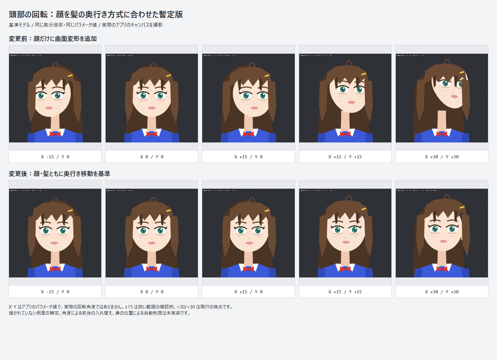

# I-039 暫定対応と画面確認（2026-10-05）

**この方式は採用を取り下げた。** ユーザーから「左右に全く動いていない」と指摘があり、左右を向いた見え方を十分に残せていないと判断した。以下は比較のための履歴。現在の desktop は [頭部共通の曲面方式](i-039-head-surface-result.md) に切り替えている。

## 今回の方針

顔の回転変形を、髪が使っている奥行き移動の方式に寄せた。顔だけに追加していた曲面の変形と斜め方向の曲面補正は、アプリの「かんたんセットアップ」では作らない。

- 顔・髪・顔の中のパーツは、既存の奥行きと共通のパラメータから移動する。パーツごとの奥行き差は残るので、全パーツを同じ量だけ平行移動するわけではない。
- 既存の顔の横幅の縮み、首・頭の傾き、目・口・呼吸・腕・髪の物理の設定は変更しない。
- 新規セットアップでは、曲面回転用の顔ワープを追加しない。
- 再セットアップでは、顔ワープの FaceAngleX / FaceAngleY / その2軸の組のバインディングのうち、手動・ロック済みキーを含まないものだけを除く。ワープ自体と基準の制御点は残す。
- 手動・ロック済みキーが1個でもあれば、そのバインディング全体を残し、奥行き方式に完全にはそろわない旨を警告する。その他の手動キーも従来どおり保護する。
- 読み込み時に保存済みプロジェクトを書き換えない。既存モデルに反映する操作は「かんたんセットアップ」の再実行で、1回の Undo で戻せる。
- core の `createAutoSetup()` は従来の曲面方式を既定のまま残し、desktop のサービスが `createAutoSetup({ faceTurn: 'depth' })` を選ぶ。スキーマ・保存形式・公開サービス契約は変更していない。

## 比較画像

基準モデル `fixtures/reference-model` を使い、同じ表示倍率・同じパラメータ値でアプリのキャンバスを撮影した。上段が従来の曲面方式、下段が今回の奥行き方式。

- [比較画像を開く](evidence/i039-depth-2026-10-05/comparison.png)
- [変更後の実画面 1600×1080](evidence/i039-depth-2026-10-05/app-after-1600.png)
- [変更後の実画面 800×700](evidence/i039-depth-2026-10-05/app-after-800.png)
- [画素確認と撮影条件](evidence/i039-depth-2026-10-05/verification.json)

確認値は `(X,Y) = (-15,0), (0,0), (15,0), (15,15), (30,30)`。これらはアプリのパラメータ値であり、実際の回転角度ではない。±15 は狭い範囲の確認例で、今回パラメータ範囲を ±15 に制限したわけではない。

この基準モデルでは、従来の大きな斜め方向で顔が髪・首から離れていた状態が抑えられた。一方で、立体的な顔の回り込みは弱くなり、正面寄りの見え方になる。正面は維持される。他のモデルでも破綻しないことを保証する確認ではない。

## 検証結果

| 確認                                                      | 結果                                                                            |
| --------------------------------------------------------- | ------------------------------------------------------------------------------- |
| core 全テスト                                             | 48ファイル・523件成功                                                           |
| desktop 全テスト                                          | 108ファイル・926件成功                                                          |
| 全ワークスペースの型チェック                              | `pnpm typecheck` 成功                                                           |
| 変更した6ファイルの ESLint                                | 成功                                                                            |
| 新規・再セットアップ、手動・ロック保護、冪等性、Undo/Redo | `depthFaceTurn.test.ts` 6件と desktop 結合テストで確認                          |
| 49方向の評価・変形                                        | X/Y 各 -30〜30 の10刻みで、曲面追加分を除いた期待結果と一致                     |
| ブラウザの実描画                                          | Edge / 1600×1080、800×700。変更前後の10画像でモデルの画素を検出、実行時例外なし |

画像は `.cache/i039-capture.mjs` で取得した。作業用プロジェクトをブラウザのメモリ上でセットアップし、元の fixture やユーザーの保存済みモデルは変更していない。開発サーバーは `http://127.0.0.1:1430/`。

Web版の本番ビルドも成功した。CL側の通常の出力先と重ならない `.cache/i039-web-build` に出力した（大きなチャンクの警告あり）。ネイティブ版のビルド・インストールとは別の確認。

## 残っていること

- 描かれていない側面の補完、回転による遮蔽・描画順の入れ替え、顔と髪の共通の頭部回転設計は未実装。
- 鼻の頂点が顔の輪郭を越えないことによる自動の角度制限は未実装。モデルごとの輪郭・鼻・髪の重なりを見て決める必要がある。
- ネイティブ Tauri アプリの再ビルド・インストール、実カメラ・OBSでの確認は今回行っていない。
- CL側で進行中の I-045 の音声実装には触れていない。その作業完了後の全体検証とは分ける。

I-039 は根本解決済みにはしない。課題管理表の I-039 本文は変更せず、根本調査は [調査方針](i-039-root-cause-investigation.md)、追加設計は [頭部回転の設計](i-039-head-rotation-design.md) を継続する。
