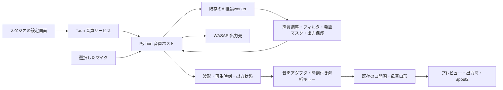

# liverVoiceChanger の AI 音声変換をスタジオへ取り込む計画

作成日: 2026-10-14（日本時間）  
状態（2026-10-15更新）: V0〜V4を実装・配置済み。元アプリとの設定差を撤回し、元のAI処理・品質プリセット・再生バッファへ戻した。V5のOBS/顔追跡を併用した全経路と本人の聴感確認は残る。

修正（2026-10-15）: Tinyは4ステップ/180ms、6/240ms、8/300ms、生成履歴400/500/500ms、開始時の余裕40msへ復元。独自のCPU/interop制限とGPU待機処理を削除し、大型AIの20/30ステップを選択可能にした。元でバランスを使っている場合はこちらも同じ品質を選ぶ。10月14日の400/600/800ms設定による約1.2秒・30分試験は撤回した設定の履歴として残し、現行性能の根拠にしない。[修正の検証結果](evidence/voice-parity-2026-10-15/README.md)、[操作説明](studio-voice-guide.md)。

音声不足の改善（同日）: TinyのAI生成を同じ計算内容のCUDA Graphで実行し、元の品質・区間長・40ms余裕を維持したまま処理時間を短縮。最速75秒の実機試験は不足・overflow・入出力異常0、内部遅延約0.57秒。周期的に区間長を変える案の比較も含め、[追加の検証](evidence/voice-underrun-2026-10-15/README.md)へ記録する。

小さい声・発話再開時の修正（同日）: VADの判定用入力だけの補正、単純な出力clipから減衰のみのピーク保護への変更、ゲイン調整後の入力メーターを追加した。この2つの音声処理は元と意図的に異なる。AI生成と品質・履歴・つなぎ合わせは維持する。音程変化時の電子感と本人の聞き取りは引き続き確認が必要。[検証範囲](evidence/voice-clarity-2026-10-15/README.md)。

発話の崩れの追加調査（同日）: 実RNNoise DLLの20ms遅延を10msとして元音声と混ぜていた不具合を修正した。これは元コードにもある想定違いで、統合側で同じ時刻へ合わせ直す。AI生成・プリセット・ユーザー設定を維持する。[測定と回帰確認](evidence/voice-articulation-2026-10-15/README.md)。

## 1. 目標と推奨方針

スタジオ画面で、マイク、AIで変換する声、声の調整、フィルタ、口の動きを一緒に設定できるようにする。利用者は声設定を選び、［音声と口の動きを開始］を押すだけで、変換した声の出力と、その声に合ったリップシンクを開始できる。

取り込み元は、同じ階層の `../liverVoiceChanger` にある現行 0.8.0 の `quality_voice/`。AI変換は **Seed-VC Tiny を標準**にし、大型 Seed-VC は音質比較用の選択肢として引き継ぐ。声の調整とフィルタは、このツールの React の画面で操作する。

音声処理は、既存の Python / CUDA / WASAPI の実装をアプリが管理する別プロセスとして取り込む。まず動作実績のある処理を再利用し、Rust への推論の書き直しは行わない。別の VoiceChanger の画面を起動する操作も不要にする。

リップシンクは、**実際に出力する音声の再生時刻を基準**にする。AI変換には遅延があるので、元のマイク音声で即座に口を動かすだけでは、配信に出る声と口がずれる。取り込みの中心は、声の設定画面と、この時刻合わせの実装とする。

## 2. 現状の確認

以下は計画作成時にローカルのソースと既存検証記録から確認した内容。取り込み後の実機測定は上の検証結果に記録する。

| 対象                 | 現在できること                                                                                          | 取り込み時に必要なこと                                           |
| -------------------- | ------------------------------------------------------------------------------------------------------- | ---------------------------------------------------------------- |
| このツールの音声入力 | `AudioSource` がマイクから音量を10msごと、波形を連続して通知する。Web Audio / AudioWorkletを使用        | AI用のネイティブ音声入力と、現在のマイク入力を同時に開かない管理 |
| 音量による口の開閉   | `MouthOpen`、無音しきい値、控えめ・標準・大きめ、カメラとの最大値・マイクのみ・カメラのみ               | AI出力に合わせて、口の開閉の更新時刻を管理する                   |
| 母音による口形       | LPCで母音を推定し、閉じる・あ・い・う・え・おの登録値を `MouthOpen` / `MouthForm` / `MouthWidth` に反映 | 変換した声での推定を確認し、音声区間を再生順に扱う               |
| 母音設定の画面       | モデリング画面で口形の登録と標準値の作成ができる                                                        | スタジオから案内し、既存の登録を再利用する                       |
| VoiceChangerのAI     | `seed-xlsr-tiny` と `seed-whisper-large`。文字起こし・読み上げを経由せず、入力の音響特徴から波形を生成  | AI方式だけを受け付ける設定・依存関係に整理する                   |
| 声の調整             | 明るさ・厚み・柔らかさを実行中に変更できる                                                              | Reactで操作し、既存workerの制御へ渡す                            |
| 雑音対策             | RNNoise、Silero VAD、発話マスク                                                                         | 音声側の発話判定と、口を閉じる判定を連動させる                   |
| フィルタ             | 5種類、最大8個、全体・個別ON/OFF、追加・削除・順序変更、実行中の調整、JSON保存                          | 一覧と設定をスタジオへ移植する                                   |
| 出力と時刻           | WASAPI入出力、有限サイズのキュー、入力・出力のサンプル番号、機器の時計ずれの補正、時刻を合わせたBypass  | 出力予定時刻・出力済み位置・最終出力の状態を外へ通知する         |
| プロセス管理         | 音声実行のWindows mutex、所有するworkerと子プロセスの終了処理                                           | Tauriからの開始・停止・異常終了に接続する                        |

### 既存測定の読み方

取り込み元の記録では、RTX 4050 Laptop 6GB / Ryzen 7 7735HS、48kHz WASAPI、Tiny最速・雑音対策ONの条件で、推定内部遅延は約561〜565ms。0.8.0のフィルタ変更を含む75秒試験では、不足・overflow・入出力statusは0、GPU割当は約1146MiB、モデル準備は約10秒だった。

大型方式は約6秒の遅延が記録されている。Tinyも「ほぼ遅延なし」とは扱わない。これらは音声アプリ単体の既存測定であり、モデル描画・顔トラッキング・Spout2・OBS・ゲームとの同時利用、30分以上の安定性、相手側までの遅延の合格を示す値ではない。統合後に測り直す。

## 3. 移行範囲

### 必須の取り込み

| 機能               | 計画                                                                                                              |
| ------------------ | ----------------------------------------------------------------------------------------------------------------- |
| AIリアルタイム変換 | Tinyを初期選択。最速・バランス・安定優先を引き継ぐ                                                                |
| 大型AI変換         | 音質比較用として移行。WAV比較に加え、ライブ選択時は待ち時間を明示する。ライブの同期・バッファも大型方式で検証する |
| 目標声             | 現行の架空声の参照WAV、独自参照WAVの選択、参照音の試聴、声プリセットの保存・読込                                  |
| 声の調整           | 明るさ、厚み、柔らかさ、入力ゲイン、出力ゲイン                                                                    |
| 雑音対策           | 雑音除去、発話以外の遮断、声の拾いやすさ                                                                          |
| フィルタ           | 電子感・金属音の抑制、歯擦音の抑制、ローパス、EQ、ゲイン                                                          |
| 出力操作           | 出力先、Mute、時刻を合わせた元音声のBypass、開始・停止、入出力メーター                                            |
| リップシンク       | 変換音声との自動連動、音量開閉、既存の母音口形、無音調整、同期の微調整                                            |
| 設定移行           | 0.8系のAI声設定・フィルタ設定の選択式インポート                                                                   |
| 比較と診断         | 利用者が選んだWAVの変換、処理時間・推定内部遅延・不足回数・GPU使用量の表示                                        |

### 後続の任意機能

「説明から目標声を作る」は、Qwen3-TTS VoiceDesignで参照WAVを事前生成する機能として後続段階へ分ける。音声変換とは別のPython環境が必要で、取り込み元には約4.7GBのGPUメモリが必要との記録がある。変換を停止して実行し、完成したWAVを新しい声設定へ登録する。ライブのマイク音声をTTSへ渡す処理は作らない。

複数出力先への同時送出、シーン別の声の自動切替、顔全体の遅延、他社の音声プラグイン追加は後続候補。初回の統合では、選んだ1つのWASAPI出力先で試聴または配信を行う。

### 移行しないもの

- `signalsmith-waveform` の直接波形加工方式、専用Pitch / Formant操作、`voice-waveform.dll`。
- 旧C++アプリのConfigurator / Runtime画面、旧Beatrice / VST3ホストとその声質混合。AIではあるが現行0.8系とは別実装なので、この計画の移行対象に含めない。
- 仮想オーディオドライバの作成・同梱。配信・通話は利用者の既存仮想デバイスへ送出する。
- 学習機能、クラウド音声変換、マイク音声の自動録音。

声調整・フィルタ・雑音対策に用いる軽い信号処理は、AI方式を使うための機能として移行する。「直接波形加工方式を除く」ことと、フィルタを除くことは区別する。このツールに元からある、AI変換なしのマイクによるリップシンクは引き続き選べる。

## 4. スタジオでの操作

### 通常の開始

1. スタジオで［音声・リップシンク］を開く。
2. マイク、声設定、出力先を選ぶ。AI未準備の場合は、その場で準備状況と導入方法を示す。
3. ［音声と口の動きを開始］を押す。モデル準備中は状態を表示し、準備完了後にマイクを開始する。
4. 中央のモデルと出力を確認しながら、声の調整とフィルタを変更する。
5. ［口の反応を合わせる］で、無音→普段の声の順に短く確認する。録音ファイルは作らない。
6. ［声設定を保存］で声・フィルタを保存する。口形はモデル、機器としきい値はこのPCの設定として覚える。

次回は機器と声設定を復元するが、マイクや配信用出力を自動開始しない。AIを使わない場合は［マイクで口だけ動かす］を選ぶ。

### パネル案

右の独立した［マイク・音声］パネルに［音声・リップシンク］を登録する。［入出力］［声の調整］［雑音対策］［フィルタ］［口の動き］のタブで切り替え、中央のプレビューを広く残す。開始・停止、Mute、状態、メーターは共通部分に常時表示する。カメラ等の［スタジオの設定］とは別々に折りたたみ・高さ変更できる。

```text
音声・リップシンク                      準備済み / 実行中
マイク [選択]   声 [Original Soft Girl ...]   出力先 [選択]
[音声と口の動きを開始 / 停止]    [Mute]    [元の声を試聴]
入力 ━━━━     出力 ━━━━━     口 ━━━

入出力 | 声の調整 | 雑音対策 | フィルタ | 口の動き

声の調整: 明るさ / 厚み / 柔らかさ / 目標声 / 品質
フィルタ: 全体ON/OFF、一覧、追加・削除・↑↓、選択項目の調整
口の動き: 音声出力と連動、反応の大きさ、無音調整、母音口形

[声設定を保存] [声設定を取り込む] [WAVで比較]
```

既存の「かんたん／詳細」モードは復活させない。内部サンプル番号などは診断表示に置く。GPU処理の数値より、利用者が選ぶ声・聴感・口の反応を中心にする。

### 実行中に変更できる項目

| 実行中に反映                                    | 停止して変更                         |
| ----------------------------------------------- | ------------------------------------ |
| 明るさ −4〜+4dB、厚み −3〜+3dB、柔らかさ 0〜6dB | AI方式、品質、参照WAV                |
| 入力ゲイン、Mute、明示的なBypass                | マイク、出力先、機器の再取得         |
| フィルタ全体・個別ON/OFF、追加・削除・順序・値  | 雑音除去・発話判定の設定             |
| 口の反応、無音しきい値、同期微調整              | 声プリセット全体の切替、目標声の生成 |

出力ゲインは既存workerでは声設定から読むため、初期移植では停止中の変更とする。実行中の音量調整には既存のゲインフィルタを使い、専用出力ゲインのライブ制御は制御APIを追加してから有効にする。

## 5. 組み込み構成



### 再利用するコード

| 取り込み元                                     | 方針                                                                      |
| ---------------------------------------------- | ------------------------------------------------------------------------- |
| `quality_voice/backend.py`                     | Tiny / 大型のモデル生成・検証を再利用。直接加工の分岐を移行版から除く     |
| `quality_voice/worker.py`                      | 推論、区間の接続、制御、発話マスクを再利用。直接加工composerを除く        |
| `quality_voice/live.py`                        | WASAPI入出力・キュー・時計補正を再利用。GUIに依存しない音声ホストから呼ぶ |
| `quality_voice/audio_processing.py`            | RNNoise / Silero / 声質調整を再利用                                       |
| `quality_voice/filter_chain.py`                | 5種類と検証・切替処理を再利用。`REGISTRY`から画面向けの仕様を取得する     |
| `execution_lock.py` / `processes.py`           | 既存アプリとの実行排他と、所有するプロセスの終了に使う                    |
| `fetch_realtime_models.py` / `fetch_models.py` | 固定revision・SHA256の検証とモデル準備へ再利用                            |
| `app.py` / `filter_editor.py`                  | GUIは移植せず、操作・制限・保存動作の参考にする                           |
| `setup-quality.ps1` / `package-quality.ps1`    | AI専用導入へ整理。直接加工DLLやプリセットが必須になっている処理を除く     |

### 新しく設ける境界

- Tauriの `voice` サービスが、音声ホストの起動、状態、設定、停止、異常終了を管理する。
- Python音声ホストは `LiveEngine` を所有し、その内側に既存推論workerを起動する。既存workerだけでは機器管理・音声出力・フロント接続を提供できないため、ホスト層を追加する。
- Reactからの設定はTauri command、連続データは専用Channelで渡す。Tauri公式では、通常のeventは低遅延・大量転送用途向けではなく、Channelをストリーム用として案内している。[公式仕様](https://v2.tauri.app/develop/calling-frontend/)
- Python↔Rustは、長さ・種類・セッション番号を持つフレーム形式のパイプとする。制御データと波形を区別し、最大サイズ・順序・応答期限を検証する。ログはstderr側へ分ける。
- マイク入出力のコールバックでは、推論、LPC、JSON化、IPC送信、ファイル書込を行わない。必要な波形・時計情報を有限キューへ渡し、別の処理で解析・送信する。
- 配信用音声はPythonから機器へ直接出す。WebViewは口の解析に使う限定的なmono波形と時刻情報を受け取り、音声の再生経路には入れない。48kHz float32で約192KB/秒の1系統を上限の目安とし、無制限に蓄積しない。
- `packages/audio` は既存の推定・口形ロジックを持ち、`schema` / `contracts` のみ参照する。Python・Tauri・画面との接続は `apps/desktop` で組み合わせ、パッケージ間参照の規則を守る。
- 音声セッションをReactパネルの寿命に結び付けない。タブの切替で音声が止まらず、メインアプリの停止・終了では確実に所有プロセスを終了する。

連続波形の転送による描画負荷は最初の試作で測る。予算を超える場合は、同じ検証音源を使って解析を音声ホストへ移す案を評価する。実測前に推定方式を二重実装しない。

## 6. リップシンクを簡単に設定する設計

### 初期設定と口形の用意

AIを使う場合、［音声出力と連動］を初期選択にする。カメラによる顔・目の追跡は継続し、口は出力音声を優先する。現在の `mouthSource` はカメラとの合成を表す値なので、それを「変換前／変換後」の選択に流用しない。音声の解析元・同期方法を別の設定として追加する。

モデルに `MouthOpen` と有効な変形があるかを調べ、無ければ作成する画面へ案内する。`MouthForm` / `MouthWidth` と対応する変形がある場合のみ、母音口形を有効にする。パラメータだけ存在していても、口の形が作られているとは扱わない。

母音の登録がある場合はその値を使う。登録が無いモデルには、既存の標準母音値から作る案をプレビューして適用できるようにする。標準値は既存の口の変形を使う設定であり、口の素材や変形自体を自動生成するものではない。既存の登録は自動で上書きしない。スタジオからモデリングの母音パネルへ移動する導線も設ける。

［口の反応を合わせる］は、数秒の無音と普段の発話から候補しきい値・反応の大きさを提示する。変換音声と発話判定を使い、ゲイン変更後も調整できる。既定値の固定適用だけで完了とせず、中央の口を見ながら適用・再調整できる。

### 音声の時刻と口の更新

1. 各区間に `sessionId`、`sequence`、`sourceStartSample`、`frames`、`sampleRate` を付ける。AIの区間長は180/240/300ms、大型では3秒。これをそのまま1つの口形にしない。
2. 波形から音量10ms・母音20msの解析を行い、区間内の細かな変化を時刻付きキューに保持する。
3. WASAPIの出力予定時刻、出力サンプル位置、時計補正の比率から、各解析窓が再生される時刻を求める。Python / WASAPIの時計と `performance.now()` の原点差・ずれを対応付ける。
4. 描画フレームでは、その時刻に再生される解析値を使う。推論完了・IPC到着・入力の捕捉時刻のいずれも、再生時刻の代わりにはしない。
5. 最終段のMute・Bypass・出力保護・機器切断を反映する。Mute中、出力の立ち上がり待ち、異常停止は口を閉じる。Bypassを明示的に使う間は、遅延を合わせた元音声に口を連動させる。

現行の `createVowelSampler` は「最後の20msの結果」を1つ持つ方式であり、180msの波形を一括投入すると区間内の変化を失う。さらに100msを超えたデータを古いものとして扱うため、大型方式にもそのまま使えない。`AudioSource`を差し替えるだけで同期対応が終わるとは扱わず、時刻付きキューと、時刻を選んで出す口開閉の更新を追加する。

まず最終出力波形による推定を使う。強いEQ・ローパス等で母音推定が悪くなる場合は、声質調整前のAI波形を母音解析用に選べるようにする。この場合も再生位置・発話マスク・Muteは最終出力に合わせ、口の開きの音量は出力に基づく。推定確度が低い区間は音量による開閉へ戻す。

同期の微調整は「口を早める／遅らせる」の1つのスライダーとして示す。初期0ms、候補範囲±300ms。未来の解析値がまだ無い場合に無理に口を先行させない。Tinyと大型で異なる推定内部遅延を、そのまま固定の補正値へ写す実装はしない。

カメラの生の口開閉と遅延済み音声の「大きい方」を取ると、発声より先に口が開く。AI出力との同期では音声優先を推奨し、カメラ優先・最大値の従来設定を選ぶときは、その違いを表示する。口以外の顔全体を約0.56秒遅らせる機能は初期範囲に含めない。

### 出力先との関係

音声はWASAPI機器へ、モデル映像は既存の出力窓・Spout2へ送る。Spout2は映像の経路であり、声が同時に渡るとは扱わない。OBSや通話ソフトでは、選んだ仮想デバイスの録音側を入力に設定する案内を設ける。プレビュー・出力窓・Spout2には同じフレームの口パラメータを渡す。

仮想デバイスやOBS側の追加遅延はアプリ内部時計だけでは分からない。アプリ内の自動同期と、配信経路での最終確認を分け、必要時に同期微調整を使う。

## 7. 設定・サービス・保存形式

### 保存場所の分担

| データ                                               | 保存先案                                                                                                                                                |
| ---------------------------------------------------- | ------------------------------------------------------------------------------------------------------------------------------------------------------- |
| 母音口形、口の反応、カメラとの合成                   | 既存の `project.model.lipSync`                                                                                                                          |
| AI音声の使用有無、選ぶ声設定、解析元・同期微調整     | 新設する `project.studio.voice`。開いたときは停止状態                                                                                                   |
| 持ち運ぶ声設定と参照WAV                              | プロジェクト内 `voice/profiles/` と `voice/references/`。プロジェクトは選択プリセットの写しを持ち、共有ライブラリの変更で勝手に音が変わらないようにする |
| マイク・出力先、入力ゲイン、音声入力別の無音しきい値 | `Environment` の音声設定。ブラウザとWASAPIの機器IDは区別する                                                                                            |
| Python実行環境、モデルソース、モデルキャッシュ       | アプリのユーザーデータ内の版別ディレクトリ。制作プロジェクトへ数GBのモデルを入れない                                                                    |
| 別モデルで再利用する声設定                           | アプリの声ライブラリ。プロジェクトに適用するときに写す                                                                                                  |
| キュー、サンプル番号、実行状態、Mute / Bypass        | 実行中だけ保持。Bypassを次回起動へ持ち越さない                                                                                                          |

モデル保存形式は実装時点の最新番号から1段更新し、旧プロジェクトには「AI音声OFF」を補う。既存のマイク・カメラの口設定や母音値は変更しない。契約の変更は `docs/contract-changes.md` に記録する。

### 追加する契約の案

- `VoiceService`: 利用可能な機能の確認、機器一覧、声設定検証、開始・停止、状態通知、声質・フィルタの更新、WAV比較。
- `VoiceStatus`: `unprepared / stopped / loading / priming / running / stopping / error`。開始キャンセルと終了待ちを含む。
- `VoicePlaybackFrame`: セッション・区間番号、サンプル範囲、再生予定時刻、最終出力の状態、解析対象。制御通知と波形転送は別メッセージにする。
- `VoiceMetrics`: 推定内部遅延、処理時間、不足・overflow、GPU割当、モデル準備時間。マイク波形をログへ保存しない。
- 解析を共通化する音声アダプタを `services.ts` で構成し、現在の `services.audio` / `services.lipSync` の利用箇所へ接続する。テスト用のfakeも提供する。

既存の `AudioSource.start(deviceId)` だけでは出力先・AI設定・停止待ちを表せない。AIエンジンの制御は `VoiceService` に持たせ、音声アダプタは解析通知を受ける役割にする。開始は準備・機器確認・音声開始をまとめて扱い、途中失敗では取得済みの資源を解放する。

### 既存の声設定を取り込む

利用者が選んだファイルをコピーして検証する。AI方式の0.8系設定は、声質、品質、雑音対策、フィルタを引き継ぐ。参照WAVは選択元の設定ファイルを基準に解決してからコピーし、保存後はプロジェクト内の相対パスにする。`sourceRepo` / `cacheDirectory` / Pythonの絶対パスは統合先の実行環境に置き換える。

フィルタ項目が無い旧設定は、取り込み元と同じく「フィルタOFF・空一覧」とする。直接加工、旧Beatrice、未知の設定版は、対応しない理由を示して取り込みを中止する。黙ってTinyへ読み替えない。

WASAPIの数値indexは接続順で変わるため永続識別子にしない。初回移植では保存した機器名・host API・入出力の特徴を再照合し、一意に決められなければ選び直す。WebViewの既存マイクIDとの自動対応は行わない。

## 8. 導入と実行時の制約

このPCの試作では、明示的に選んだ既存の `liverVoiceChanger` のPython環境・モデルを読んで使えるようにする。取り込み元を変更せず、設定の写しとログはこのツール側に置く。配布版は兄弟フォルダの存在に依存させず、版を固定した音声コードとAI専用導入手順を持つ。

初期の実機対象はWindows 10/11 x64、Python 3.12 x64、AVX2 CPU、CUDA対応NVIDIA GPU。既存の依存版とソースrevisionを引き継ぎ、GPU・モデル・RNNoise DLL・Sileroモデル・参照WAVを開始前に検査する。非対応PCでもモデル編集と現在のマイクによるリップシンクは使える。

音声モデルは初回導入時に準備し、通常実行はofflineとする。ダウンロードの進捗、中断、再開、revisionとSHA256の検証を用意する。モデルが無い状態で［開始］を押すと裏で長時間ダウンロードし続ける設計にはしない。

既存の `Local\VoiceChanger-Audio-v1` mutexを継承する。元アプリが音声実行中なら、このツールからは開始できない理由を示す。元アプリを自動終了しない。開発・導入スクリプトでは直接加工DLLが無くてもAI専用構成が動くことを確認する。

停止、GPUエラー、出力不足、機器切断では出力を無音にし、古い音声・口形を破棄する。元の声や別の機器への自動切替はしない。復旧は機器・品質を確認して再開始する。終了時は自身の音声ホストと推論workerを止め、GPUとmutexの解放まで確認する。

配布前に依存ソース・モデル・参照素材の条件を整理する。取り込み元の `backend.py` / `worker.py` は `GPL-3.0-or-later` 表記、固定したSeed-VCソースはGPL-3.0のライセンスを持つ。別プロセス化だけを根拠に配布条件の判断を済ませず、統合版のソース提供、ライセンス文書、モデルの別途導入方針を確認してから配布する。[固定revisionのライセンス](https://github.com/Plachtaa/seed-vc/blob/51383efd921027683c89e5348211d93ff12ac2a8/LICENSE)

## 9. 実装順と完了条件

各段階は前の段階が通ってから進める。既存の制作モデル本体を検証用に変更せず、写しを使用する。

| 段階                   | 主な作業                                                                                              | 完了条件                                                                                                     |
| ---------------------- | ----------------------------------------------------------------------------------------------------- | ------------------------------------------------------------------------------------------------------------ |
| V0: 境界と性能の試作   | AI専用環境の検査、ホスト起動、Tauri制御、出力時計通知、連続波形Channelの試作、描画との同時測定        | Tinyの変換と再生が動き、同じ音声区間の再生時刻を画面側で追える。ソース・依存版・転送量・同期誤差の記録がある |
| V1: AI音声の統合       | 機器一覧、Tiny / 大型、参照WAV、品質、開始・停止、Mute / Bypass、メーター、状態・診断、既存実行排他   | 別GUIなしで開始・停止できる。中断・切断・異常後に子プロセスとGPUを残さず再開始できる                         |
| V2: 声調整・フィルタ   | Reactの各タブ、声質3項目、雑音対策、5種類・最大8個のフィルタ、実行中の更新、声・フィルタ保存、WAV比較 | 取り込み元と同じ設定を再現し、実行中の変更と保存・再読込が通る                                               |
| V3: 音声と口の自動連動 | 時刻付き解析、口開閉のスケジュール、母音、無音調整、同期微調整、カメラ口との設定、停止時の口閉じ      | ［音声と口の動きを開始］で一緒に動く。無音・Mute・Bypass・再開で整合し、プレビューと映像出力が一致する       |
| V4: 設定移行・導入     | プロジェクト保存、声ライブラリ、AI声設定のインポート、相対パス、モデル準備、配布用依存整理            | 元設定を保持して移行できる。兄弟フォルダの無いPCでもAI専用手順で導入・実行できる                             |
| V5: 統合の受入確認     | Tiny・大型、実マイク、仮想デバイス、OBS / Spout2、30分試験、聴感・操作、文書                          | 次節の必須条件が通り、測定値と残る制約を記録して通常版へ反映する                                             |
| V6: 任意の目標声生成   | VoiceDesign環境、生成ジョブ、キャンセル、試聴、新規声登録                                             | ライブ変換と競合せず、既存の声を上書きせず参照WAVを作れる                                                    |

最初の内部試用はV0〜V3を一まとまりにする。声だけ動く段階を「リップシンク統合完了」とは扱わない。一般配布にはV4〜V5も必要。

### 作業場所の案

| 場所                                                              | 変更内容                                                                                 |
| ----------------------------------------------------------------- | ---------------------------------------------------------------------------------------- |
| `tools/voice-engine/`                                             | AI専用のPythonコード、音声ホスト、固定依存一覧、モデルmanifest、取り込み元の版・変更記録 |
| `tools/voice-engine/tests/`                                       | 既存AI・雑音・フィルタのテストを引き継ぎ、IPC・再生時計・停止の検証を追加                |
| `apps/desktop/src-tauri/src/voice/`                               | プロセス管理、command / Channel、時計、機器・状態・解析データの橋渡し                    |
| `apps/desktop/src/services/voice/`                                | フロントのVoiceServiceと音声アダプタ                                                     |
| `apps/desktop/src/modes/studio/voice/`                            | 声・入出力・雑音・フィルタ・設定移行の画面                                               |
| `apps/desktop/src/modes/studio/lipsync/`                          | 一括開始・停止、調整導線、時刻対応                                                       |
| `packages/audio/src/`                                             | 既存の解析を再利用した時刻付きキュー、同期した口開閉                                     |
| `packages/schema/src/` / `packages/contracts/src/`                | 保存・サービス・解析通知の型、検証、移行、fake                                           |
| `apps/desktop/src/services.ts` / `modes/index.ts` / Rust `lib.rs` | 組み合わせ、パネル・機能の登録、終了処理                                                 |
| `tools/app/` / Tauri bundle設定                                   | AI専用導入・音声コード配布・ライセンス文書                                               |

移植開始時に取り込み元のファイルhashを記録し、`dist/` 全体や仮想環境をそのままコピーしない。音声コードの更新は版を指定した取り込みにし、実行のたびに兄弟リポジトリから最新ファイルを読む構成にしない。

## 10. 受入条件と測り方

以下の数値は統合後の**目標**であり、達成済みの値ではない。V0で試験条件と基準値を記録し、変更が必要なら理由を残す。

| 観点                 | 条件と確認方法                                                                                                                          |
| -------------------- | --------------------------------------------------------------------------------------------------------------------------------------- |
| 設定の簡単さ         | AI準備済みなら、機器・声設定の選択と1つの開始ボタンで声と口が動く。2つのアプリ間で声設定を渡す作業が不要                                |
| AI限定               | 移行版に直接加工方式・専用DLL・旧VST3が不要。対応しないプリセットを勝手に変換しない                                                     |
| 声とフィルタ         | 3つの声質項目、5種類・8個、全体・個別・順序・実行中変更・保存・読込。既存の応答・連続性テストと同じ音源で比較                           |
| 内部遅延             | 同じPC・Tiny最速・同じ機器で、既存約0.56秒からの増加を50ms以内に抑える目標。音声単体と統合時のp50/p95・最大を併記し、通話遅延とは分ける |
| スケジュールの正確さ | 合成の開閉音源で、予定した口更新と音声出力時刻の差の絶対値をp95で50ms以内にする目標。AI発音の変形とは別に測る                           |
| 実際の声と口         | 既知の発話の変換音声と映像を、利用者が選んだ検証録画で比較。口の開閉のずれを80ms以内の目標で確認し、母音形は目視・聴感も評価する        |
| 連続した区間         | Tinyの180/240/300msと大型3秒の内部で口形が変化し、最後の母音だけにならない。時計ずれ・IPC遅延・未来窓・再開で検証                       |
| 無音・Mute・Bypass   | 発話マスク外で口が閉じる。Muteでは最終出力と連動。Bypassは遅延の合う元音声と連動。停止で音声・口形の待ち行列を破棄する                  |
| 安定性               | 描画・顔追跡・Spout2・OBSを併用した30分で不足・overflow・入出力status 0。フィルタ8個、無音→発話、連続発話を含める                       |
| 描画への影響         | 同じモデル・出力条件で描画フレーム時間p95の悪化を10%以内に抑える目標。ゲーム併用は別条件として測る                                      |
| 資源と停止           | モデル準備のキャンセル、開始直後の停止、繰返し開始・停止、アプリ終了、worker強制異常の試験で、自身のプロセス・mutex・GPUが残らない      |
| 保存と移行           | 既存プロジェクトの口設定を保持。AI声設定とフィルタを保存・再読込し、プロジェクト移動後も参照WAVを解決。元設定は不変                     |
| 配信経路             | 仮想デバイスとOBSで音声・映像の両方を確認。音声の二重入力が無く、出力窓・Spout2・プレビューの口値が一致する                             |
| 表示                 | 最小960×600でも開始・停止・Muteにアクセスでき、フィルタ設定がはみ出さない。ブラウザ開発ではAI未対応の状態をfakeで確認できる             |

このツールのVitest / 型検査 / lintと、Python側の既存AI・フィルタ・雑音テストを適切な範囲で実施する。音声時刻・画面・保存・終了をe2eで結合確認し、数値テストだけで音質や口形の合格を決めない。聴感確認は同じ発話をフィルタON/OFFで比較する。

開発サーバー、アプリ更新、e2eはリポジトリの規則に従って `.cache/locks/main.lock` を取得する。起動中の利用者のアプリを断りなく閉じない。制作プロジェクトのパーツ・変形を触る必要が生じた場合は、`tools/model-authoring/README.md` の手順を適用する。

## 11. 初期採用案と、試作で判断する点

初期採用案は、Tiny最速、現行の架空参照声、雑音除去85%、発話以外の遮断ON、拾いやすさ40、弱い3フィルタ、音声出力に口を連動、1つの出力先とする。既存設定を取り込んだ場合は、その値を優先する。

| 判断する点                    | 判断材料・時期                                                                                                           |
| ----------------------------- | ------------------------------------------------------------------------------------------------------------------------ |
| GPU同時使用の余裕             | V0で音声・追跡・描画を同時測定。V5でOBSとゲーム条件を追加                                                                |
| 母音推定への声変換・EQの影響  | V3で変換前後・フィルタ前後の同じ発話を比較し、必要なら母音解析元の選択を用意                                             |
| 音声以外の顔との時間差        | V3で利用者がプレビュー・配信を確認。顔全体を遅らせるかは後続の選択肢                                                     |
| Python実行環境の配布方法      | V4で、固定環境を用意する導入スクリプトを基本に、新規PCで再現確認。埋め込みPythonは依存のサイズ・導入成功率を見て別途評価 |
| 初期声とフィルタの聴感        | V5で本人の発話を試聴して採用。既存の数値記録だけでは決めない                                                             |
| VoiceDesignを同時に取り込むか | V0〜V5の完了後、参照WAVの生成が必要ならV6へ進む                                                                          |

## 12. 確認に使ったソース

このリポジトリ:

- [音声契約](../packages/contracts/src/index.ts)、[保存形式](../packages/schema/src/types.ts)、[サービスの結合](../apps/desktop/src/services.ts)
- [音声入力](../packages/audio/src/source/source.ts)、[口開閉と母音の合成](../packages/audio/src/lipsync/lipSync.ts)、[母音の区間処理](../packages/audio/src/vowel/sampler.ts)
- [スタジオのリップシンク](../apps/desktop/src/modes/studio/lipsync/LipSyncSection.tsx)、[母音の標準設定](../apps/desktop/src/modes/modeling/vowels/commands.ts)
- [Tauriの登録と終了処理](../apps/desktop/src-tauri/src/lib.rs)、[開発規則](dev-guide.md)、[モデル制作の手順](../tools/model-authoring/README.md)

兄弟リポジトリ（この文書の `docs/` から `../../liverVoiceChanger/`）:

- [現行版README](../../liverVoiceChanger/README.md)、[AI方式の説明](../../liverVoiceChanger/quality_voice/README.md)
- [AIバックエンド](../../liverVoiceChanger/quality_voice/backend.py)、[推論worker](../../liverVoiceChanger/quality_voice/worker.py)、[WASAPIと再生時計](../../liverVoiceChanger/quality_voice/live.py)
- [声質・雑音処理](../../liverVoiceChanger/quality_voice/audio_processing.py)、[フィルタ実装](../../liverVoiceChanger/quality_voice/filter_chain.py)
- [リアルタイム測定](../../liverVoiceChanger/docs/realtime-validation.md)、[フィルタ仕様と測定](../../liverVoiceChanger/docs/filters.md)、[モデル準備](../../liverVoiceChanger/docs/model-preparation.md)
- [導入スクリプト](../../liverVoiceChanger/scripts/setup-quality.ps1)、[配布スクリプト](../../liverVoiceChanger/scripts/package-quality.ps1)、[依存・ライセンス記録](../../liverVoiceChanger/THIRD_PARTY_NOTICES.md)

外部の一次資料は、本文中のTauri公式Channel説明と、採用済みSeed-VC固定revisionのライセンス。新しい推論方式の選定・ライブラリ更新は今回の計画に含めていない。
