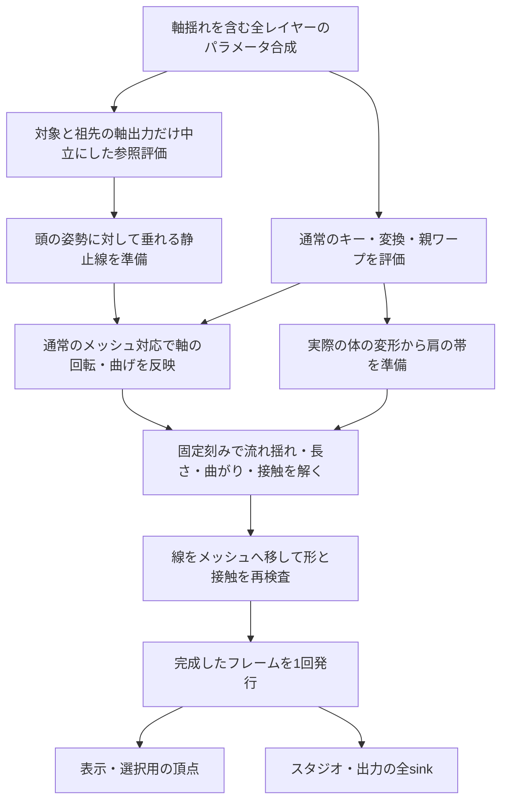

# 流れ線を使う髪の慣性・肩との接触の設計

2026-10-08 CO。ユーザーの「慣性の揺れ・肩との衝突の設計はありますか？なければ設計して」に対応する設計。既存の[流れ線の設計](curve-guide-design.md)には遅れ・揺れ・減衰の方針だけがあり、接触形状、計算、状態、保存、検証の具体案は無かった。本書でそれらを定める。**設計済み・製品への実装は未着手**。調査した製品コードは `102a12e`。

[カード99](cards/99_curve-guide.md)で実装した、一本の線・3点での編集・頭に付く根元・静的な重力補正を土台にする。99の完了範囲を変更せず、次の実装カードと契約の番号は計画へ組み込むときに決める。今回の依頼は設計であり、STEP3の受け入れや他のSTEP4カードの開始を行った記録にはしない。

同日のユーザー指定により、名称は［流れ線で揺らす］とし、**同じパーツで軸揺れと流れ揺れを併用できる設計**へ更新した。以前の後続案にあった排他・切替は、この設計では採用しない。カード99の実装済みの排他動作を変更した記録ではない。[パレットの表示設計](../modeling-palette-design.md)も確認し、設定の置き場所と表示条件を合わせる。

## 目指す動きと最初の範囲

頭を横へ動かすと、根元は頭について動き、下側は少し遅れる。頭を止めると毛先が行き過ぎ、数回の小さな揺れを経て垂れた形へ戻る。肩へ届いた毛束は、長さを保ちながら肩の上や外側へ曲がり、肩から離れれば再び垂れる。肩も体のキー・変形に追従する。

最初は99と同じ、子を持たない髪の画像パーツ1枚・流れ線1本を対象にする。複数の独立した毛束は、それぞれに設定できる。肩はメッシュのある体・服の画像パーツへ付けた線で表す。別画像のハイライトを同じ髪へ追従させる機能、髪同士の衝突、3Dの前後やねじれ、体側の反動は後続とする。

## 軸揺れと流れ揺れの役割と名称

既存の［揺らす］は `modeling/physics/sway.ts` で、パーツのピボットを中心に回転するキーを作る。画像パーツには先端へ向かうほど強い頂点の曲げも追加するため、「既存方式は全体の回転だけ」とは説明しない。回転・曲げを同じ揺れパラメータのキーで制御する方式で、流れ線を毎刻み解く方式ではない。

| 方式               | 動きの基準                                                                   | 使う場面                                                 |
| ------------------ | ---------------------------------------------------------------------------- | -------------------------------------------------------- |
| 軸揺れ（既存方式） | ピボットを中心とした回転と、画像の先端側の曲げのキー                         | 軸を中心に振る動きを手軽に付ける                         |
| 流れ揺れ（新方式） | 頭に付く短い根元の区間と、垂れた静止線。線の途中が曲がり、毛先側が遅れて動く | 長い髪など、吊られたものが垂れた形へ戻りながら揺れる動き |

新方式では根元ほど追従を強く、毛先側ほど自由にする。「毛先側ほど動きやすい」が基本のイメージだが、肩に毛先が載る場合は途中の区間が動くこともあり、常に毛先の振幅が最大になる制約は置かない。先端への単純な移動量の倍率だけで両方式を区別しない。

画面のスイッチ名は、既存を［軸で揺らす］、新方式を［流れ線で揺らす］とする。説明・見出しには［軸揺れ］［流れ揺れ］を使う。名称は今回の設計へ反映し、既存製品の表示はまだ変更していない。

### 同じパーツで両方を使う

軸揺れは回転と既存の曲げキーを作り、流れ揺れはその動きを受けた線の遅れ・余韻を計算する。同じ髪で両方をONにでき、それぞれの揺れの大きさ・収まりの設定を独立して調整する。片方のONで他方の設定、出力パラメータ、バインディング、手動キーを解除・削除しない。

| 軸で揺らす | 流れ線で揺らす | 動作                                                                       |
| ---------- | -------------- | -------------------------------------------------------------------------- |
| OFF        | OFF            | 通常のキーと線の編集。指定があれば静的な重力補正・肩接触だけを使う         |
| ON         | OFF            | 軸の回転・曲げキーで動く。流れ線の静的な重力補正・肩接触とも併用できる     |
| OFF        | ON             | 通常の姿勢の変化を受け、流れ線に沿った遅れ・余韻を加える                   |
| ON         | ON             | 軸の動きを保ち、その動きを受けた流れ線へ遅れ・余韻・指定した肩接触を加える |

両方ONでも、根元の固定先は軸揺れを反映した現在の付け根である。流れ揺れを有効にする前提は、有効な流れ線と［重力に沿わせる］。軸揺れのON/OFFは前提にしない。軸揺れは流れ線なしでも使える。親の軸揺れと子の流れ揺れも同じ評価順で扱い、親子へ設定を自動継承しない。

## 流れ線と揺れは対象ごとに別に有効化する

**流れ線を指定しただけでは、慣性による揺れを追加しない。** 流れ線は形の編集にも使うため、線があることを揺れる対象の判定に使わない。新しく描く流れ線と既存プロジェクトの両方で、［流れ線で揺らす］は初期OFFとする。利用者が選んだ対象で明示的にONにした場合だけ、その流れ線へ慣性を加える。

| 使い方                     | 重力に沿わせる | 流れ線で揺らす | 肩の指定 | 動作                                                         |
| -------------------------- | -------------- | -------------- | -------- | ------------------------------------------------------------ |
| 線で形を整えるだけ         | OFF            | OFF            | なし     | 線の編集結果と通常のキー・親の変形を使う                     |
| 頭が傾いても垂れる形にする | ON             | OFF            | なし     | 99の静的な重力補正だけを使い、遅れ・行き過ぎ・余韻を加えない |
| 選んだ髪だけ揺らす         | ON             | ON             | なし     | その髪にだけ慣性と減衰を加える                               |
| 揺らさず肩に当てる         | ON             | OFF            | あり     | 現在姿勢で静的な接触だけを解き、慣性の履歴は持たない         |
| 揺らして肩に当てる         | ON             | ON             | あり     | 指定した髪にだけ慣性と接触を加える                           |

上の表は流れ線側の設定を示す。どの行でも軸揺れを独立して使える。［揺らさず肩に当てる］は流れ揺れの履歴を持たない意味で、軸揺れがONなら軸による動きは続く。

線を作る/描き直す、中間点を動かす、重力をONにする、揺れのプリセットを選ぶ、肩を指定する操作で、揺れのON/OFFを自動変更しない。親パーツ・同じ種類のパーツ・他の流れ線からの自動継承や、全流れ線への一括有効化も行わない。複製は既存の保存された設定をコピーするが、元からOFFの対象をONへ変更しない。

［流れ線で揺らす］をOFFにしたら、その対象の流れ揺れの履歴と残る速度だけを破棄し、次の評価で軸揺れを反映した静止線へ戻す。肩が指定されていれば静的な接触は続ける。軸揺れの設定と履歴、他の対象の設定・履歴には触らない。通常のキーや親の変形への追従も維持する。再びONにしたときは現在姿勢から初期化し、OFFにした前の流れ揺れを再開しない。

### パーツ一覧の揺れの目印

揺れを設定したパーツの名前の横に、方式ごとの14〜16pxのアイコンを表示する。ユーザーの指定により、**軸揺れは振り子、流れ揺れは風鈴**とする。以前の共通アイコン1つの案を置き換え、一覧だけで方式を見分けられるようにする。流れ線があるだけ、静的な重力だけ、肩の接触だけのパーツには付けない。親や兄弟へ目印を自動で付けない。

| 設定           | パーツ名の横の目印    | ツールチップ・読み上げ名             |
| -------------- | --------------------- | ------------------------------------ |
| 軸揺れだけON   | 振り子1つ             | ［軸揺れ：ON］                       |
| 流れ揺れだけON | 風鈴1つ               | ［流れ揺れ：ON］                     |
| 両方ON         | 振り子、風鈴の順で2つ | それぞれのアイコンで方式と状態を示す |
| 両方OFF        | なし                  | —                                    |

両方の図柄は**模様や塗り分けのない単色の線画**とする。文字色に合わせた `currentColor` を使い、線の太さを既存の目・鍵へ揃える。振り子は上の固定支点・斜めの棒または糸・下の丸い重りで表す。風鈴は笠・吊り糸・短冊で表し、振り子の丸い重りと風鈴の短冊を14pxでも見分けられる形にする。花柄・飾りの模様・陰影・グラデーションを加えない。単にカラー版を単色へ変換するだけでは、残った装飾が条件を満たすとは扱わない。ライト/ダークテーマでも同じ輪郭を使う。

アイコンは設定の有無を示し、動いている間だけ点滅/揺動する表示にはしない。再生停止中も設定がONなら残す。片方をOFFにしたらその方式のアイコンだけを消し、もう片方を残す。両方ONのときに1つへまとめたり、どちらかで上書きしたりしない。

線の無効化・重力OFF・対応の失効で流れ揺れだけが実行できない場合は、風鈴だけを薄く表示して停止理由を添え、動ける軸揺れの振り子は通常の表示を保つ。停止理由は方式ごとに示す。目・鍵の操作とは分け、目印を押しただけで設定を切り替えない。色だけで区別しない。2つの間隔は2pxを初期案とし、パーツ名が長いときも両方の幅を確保する。狭い画面では名前を省略し、目印や既存の目・鍵を隠さない。キャンバスを狭める列の追加は行わない。

現在のパーツ一覧は `modeling/structure/ui.tsx` の14pxの線画SVGを使い、専用のアイコンパックの依存はまだ無い。軸揺れ用は、上記の基本形を既存SVGと揃えて描く振り子を案とする。流れ揺れ用には、これまで調べた次の2候補がある。パックと図柄の最終採用・素材追加は未実施。

| 候補                                                            | 図柄と採用する場合の扱い                                                                                                                                                                                              |
| --------------------------------------------------------------- | --------------------------------------------------------------------------------------------------------------------------------------------------------------------------------------------------------------------- |
| [Lucide / bell-ring](https://lucide.dev/icons/bell-ring)        | 模様のないベルの単色線画で、見た目の第一候補。ISC。[ライセンス](https://lucide.dev/license)に従って著作権表示を同梱する                                                                                               |
| [OpenMoji / wind chime（1F390）](https://openmoji.org/library/) | 風鈴の形を探した際の候補。単色SVGもあるが、採用するなら模様がないことも確認する。[公式リポジトリ](https://github.com/hfg-gmuend/openmoji#license)で図版はCC BY-SA 4.0とされている。採用時は出典とライセンスを記録する |

流れ揺れ用は単色・模様なしの指定に合わせ、Lucideの線画を第一候補とする。最終の図柄は風鈴の基本形と振り子との14pxでの判別を満たすものを選び、既存候補で満たせなければ同じ線の太さの専用SVGを描く。軸揺れにはベルの図柄を流用せず、振り子を使う。両方のSVGはローカルへ同梱し、表示時に外部CDNから取得しない。絵文字フォントの文字をそのまま使う方式では、PCごとに形が変わるため、同梱した同じ図柄を使う。

2Dの絵では肩の手前を通る髪と奥を通る髪を座標だけで区別できない。接触する肩は**髪ごとに指定**する。描画順から自動で衝突相手を選ばず、描画順・クリッピングも物理計算では変更しない。奥の髪には肩を指定しない使い方もできる。最初の接触形状は肩の周辺の帯であり、胴体全体の閉じた体積を表すものではない。

## 制作する人の操作

1. 今ある［流れ線］で髪の形を作り、［重力に沿わせる］をONにする。
2. 揺らしたい髪を選び、流れ線のパレットの［流れ線で揺らす］を明示的にONにする。このスイッチは初期OFF。ONにしたときのプリセットは「標準」。基本の調整は［揺れの大きさ］と［収まりの速さ］の2つにする。「柔らかめ・標準・硬め」のプリセットも選べる。流れ揺れを加えない対象ではこの手順を省く。軸揺れも使いたい場合は、同じ髪の「パーツの設定」で［軸で揺らす］を独立してONにする。
3. ［肩に当てる］→［肩の線を追加］で、線を付ける体・服のパーツを選び、左肩または右肩の当てたい縁をなぞる。肩の帯を半透明で表示し、太さは1つのつまみで調整する。髪と同じ線の制御点を操作する必要はない。
4. 対象の髪に左肩・右肩の線を指定し、［動きを試す］で頭を左右に動かして、遅れ・収まり・接触を確認する。プレビューを止めたら編集用の静止形へ戻る。

肩の線はクリック2点でも作成でき、なぞった線は2〜8点の折れ線へ整える。追加した直後は選択中の髪にだけ関連付ける。他の髪には明示的に追加する。肩の線の選択・点の移動・太さ・名前・削除を編集できる。Escで取消、1操作で1回のUndoにする。

衝突時の髪の太さはメッシュから求める。基本表示には髪の太さの倍率だけを置き、頂点の重みや質量を入力させない。流れ線の［影響幅］は編集で動かす範囲であり、衝突の太さとは別の値。狭すぎる影響幅・分岐したメッシュで毛束全体を動かせない場合は、接触の設定前に理由と修正箇所を表示する。

［流れ線で揺らす］がOFFでも、［肩に当てる］をONにすれば静止形の接触を解く。新規の流れ線と既存プロジェクトは、流れ揺れOFF・肩の指定なしで始める。既存の軸揺れは保存された状態を維持する。重力をOFFにする、流れ線を無効にする、現在キーへ形を記録する操作では、流れ揺れと接触を実行しなくなる。流れ揺れの設定は残し、再開時に現在姿勢から初期化する。軸揺れは止めない。

### パレットの表示設計との接続

[モデリングのツールとパレットの整理](../modeling-palette-design.md)の決定D1〜D5に合わせる。軸揺れは共通の「パーツの設定」に置き、流れ揺れ・肩の指定は「線で曲げる」ツール選択時に出る流れ線のオブジェクトパレットへ置く。既存の右列の上部を使い、列を増やさず、キャンバスの幅・高さを変えない。流れ線のⓘには「形の編集」「重力に沿わせる」「選んだ対象だけ揺らす」の用途と、軸揺れと併用できることを説明する。

ツール・パーツの切替でパレットが非表示になっても、保存設定と実行中の揺れは変えない。パレットのmount/unmountを物理セッションの寿命やON/OFFに使わない。選択対象が無い間の帯・クリック選択・右クリックで選ぶ段へ戻る処理はパレット設計の枠に従い、流れ線を描くクリックやEscの取消を妨げない。選び直した対象の設定だけを編集する。

CC-012のshell差し込み口と、ワープ/流れ線の登録を変更する方針を確認した。本書の後続実装で同じファイルへ入る前には、その変更済みの登録と条件を読み直して利用する。子ウィンドウ化はパレット設計で未決定のため、この設計でも前提にしない。

## 現在の実装と接続方針

| 現在の場所                                          | 現状と追加するもの                                                                                                                                     |
| --------------------------------------------------- | ------------------------------------------------------------------------------------------------------------------------------------------------------ |
| `packages/core/src/deform/curveGuide.ts`            | 49点の線、根元の区間、弧長の対応、横幅を保つ頂点への写像、三角形の保護。静止線の評価と、指定した最終線をメッシュへ移す処理に分けて再利用する           |
| `packages/core/src/deform/pipeline.ts`              | 頂点キー→自身の変換→親ワープ/変換→流れ線。軸揺れを含む通常の変形と、必要な対象だけの中立評価を準備し、静止線・肩・動く髪の順で完成させる入口を追加する |
| `packages/core/src/physics/engine.ts`               | 入力パラメータから振り子の出力パラメータを作る既存エンジン。新しい空間の毛束計算は別の `hairDynamics/` に置く                                          |
| `apps/desktop/src/modes/studio/runtime.ts`          | 全レイヤーを合成して変形し、同じ `StudioFrame` をプレビューと全sinkへ渡す。このフレーム生成で新計算を1回だけ進める                                     |
| `apps/desktop/src/modes/animation/Preview.tsx`      | 現在は静的な `pipeline.deform`。連続再生でだけ専用の履歴を持ち、シークは静止評価で初期化する                                                           |
| `apps/desktop/src/modes/modeling/curveGuide/`       | 既存の3点の線、逆変換、キー編集、既存物理との切替。揺れ・接触の設定と試す入口を追加する                                                                |
| `packages/schema/src/types.ts` / `packages/io/src/` | 現在はschemaVersion 4、`Model.curveGuides`。設定・肩・参照の検証、移行、削除/複製/反転/再読込の扱いを追加する                                          |

現在の99の重力補正は、根元の線の角度差から頭の傾きを下側ほど取り除く静的な計算。質点へ重力を積分する物理計算ではない。今回もその線を「静止したときに戻る形」として使う。**同じ線へさらに下向きの重力加速度を足さない**。既存のカールと99の静止姿勢を維持するための、制作向けの慣性モデルとする。

後続実装では99の排他を外す。`curveGuide/commands.ts`の重力ON時の既存物理解除、`physics/commands.ts`の流れ線の重力による軸揺れの作成禁止、`PhysicsSection.tsx`の排他表示・操作不可を変更対象にする。両方式の切替確認や自動削除を併用操作へ残さない。既存物理の重複作成、ロック、失効の保護は維持する。カード98の胸の揺れの拡張は別の契約・実装範囲であり、肩を体の最終変形に付ける接続以外を混ぜない。

## 座標と1フレームの処理

計算座標は `DrawItem.positions` と同じモデルのキャンバス座標（下向きが+y）。体の移動や頭の回転のキーは慣性の入力になる。編集キャンバスのズーム・パン、出力の解像度・配置・倍率は表示変換なので揺れの入力にしない。現在の `Scene.modelTransform` は位置と一様倍率だけで、回転の項目は無い。将来シーン回転を導入する場合の重力座標は、その契約時に別途決める。



通常の変形後の頂点、肩、静止線を同じモデル/パラメータのスナップショットから作る。肩の取付先に実行中の流れ線パーツは指定できない。髪を動かしてから肩を求める循環を作らない。

### 重力補正が軸揺れを消さないための合成

99のまま軸揺れの後へ重力補正を置くと、根元の角度差に含まれる意図した軸の回転まで下側で取り除いてしまう。単に排他チェックを外すだけでは併用できたとは扱わない。**頭の姿勢に対する垂れ方を求める → 軸の動きを反映する → 流れ揺れと接触を解く**順序を、次の対応で実現する。以下は試作で成立を確認する計算案である。

1. 既存の物理producerは1フレームに1回だけ進め、実際の合成済みパラメータ `P` を確定する。対象の髪と祖先にある `Project.physics` から、軸揺れの出力パラメータIDを集める。
2. `P`のうち、そのIDだけ軸の中立値0へ置き換えた参照 `P0` を作る。入力の頭角度、表情、他の通常キーは同じ値とする。0は既存エンジンの軸出力に合わせる値で、任意のパラメータのdefaultへ置き換える意味ではない。保存された値やキーは変更せず、参照評価でproducerの履歴・時刻を進めない。共有IDは一度だけ置換する。出力範囲が0を含まず中立を評価できない対象は診断して合成を使わない。
3. 流れ線適用前の通常の対象メッシュを、`P0`で `B0`、`P`で `B1` として準備する。`B0`を使って99の編集線と静的な重力補正を評価し、軸の動きを含まない静止線 `q0(s,t)` を得る。
4. 作成時の線の各サンプルの取付け三角形を固定して使う。`B0`上の重心座標の取付け点を `a0`、同じ三角形・座標の`B1`上の点を `a1`、両三角形の辺の2×2行列を `E0`、`E1` とする。`J=E1*inverse(E0)`で局所の対応を求め、`q(s,t)=a1+J*(q0(s,t)-a0)`を軸揺れ反映済みの静止線とする。回転だけなら垂れた形全体にその軸の回転を保てる。既存の先端の曲げ、祖先の軸揺れ、親ワープも実際のメッシュの対応から移す。
5. 流れ揺れは、この`q`へ戻る線として解く。根元は`q`に固定し、肩は参照`P0`ではなく実際の`P`の体から求める。完成メッシュは`B1`の元の線から最終線へ1回だけ写す。完成後に軸の回転を再適用したり、`B1`の根元角度で重力補正を再計算したりしない。

直毛を剛体回転だけで揺らす見本では、`q = pivot + R_axis * (q0 - pivot)`となることを確認する。軸が動く間はその意図した角度を保ち、中立へ戻れば頭の姿勢に対して垂れる線へ戻る。流れ揺れがOFFでも、この合成を使って軸揺れと静的な重力補正・接触を併用する。流れ揺れをONにしたら、軸の動きも`q`の移動として遅れの入力になる。さらに同じ軸パラメータの加速度や回転を別途足さない。

`E0`が退化して逆変換できない、対応途中で新しい反転が起きる、有限でない場合は、その対象の流れ線の補正を採用せず、軸揺れを含む通常の`B1`へ戻して理由を表示する。設定はOFFへ書き換えない。静止線を作れなかったフレームを接触成功とは扱わず、指定した肩は未解決として通知する。親の左右反転だけを失敗とせず、99と同じく開始時の向きに対する新しい反転を検査する。隣接三角形で`J`が変わるときの段差は、直毛・カール・太い毛束と親ワープの試作で評価し、不成立なら対応の補間を再検討する。

軸出力IDの組とモデル/パラメータのスナップショットが同じ参照準備は再利用し、髪の本数だけ全モデルの評価を繰り返さない。実際の表示と肩は常に`P`を使い、対象の参照評価で他のパーツの完成結果を変更しない。中立評価を含む費用を性能検証へ含める。

`DeformPipeline.deform(model, deltas)` は履歴を持たない既存互換の入口として残す。この引数だけでは`Project.physics`と合成前のパラメータを取得できないため、併用の参照情報を内部で推測しない。新しい共通のフレーム評価器は`Project`・合成済みパラメータ・時刻/フラグを明示的に受け、`prepare`で通常の変形と中立参照/静止線を作り、明示的な `HairDynamicsSession` が線を計算し、`finish`で最終頂点を作る構成にする。併用するモデルのモデリング表示・選択・アニメーション・スタジオは、静止評価もこの入口へ統一する。これらは契約案であり、現在のAPIにはまだ無い。

履歴を持つセッションはスタジオ、モデリングの［動きを試す］、アニメーションの連続再生ごとに独立させる。同じセッションで1つのフレームIDを2回進めない。同じフレームの再描画・選択・出力では完成結果を再利用する。異なるセッションは同じ時刻でも異なる過去を持てるため、同じ結果になる要求は「同じ初期化・入力履歴」に対して行う。後続機能なしの既存の許可された組合せでは99の頂点と一致させる。従来は排他で使えなかった軸揺れと重力補正の組合せには、セッション無しでも上記の静的な合成を使う。

実行対象は各流れ線の保存された設定から選ぶ。`dynamics`が無い、または`dynamics.enabled`がfalseの線は、流れ揺れの節点・速度を作らず計算を進めない。有効な肩も軸揺れも無ければ、99の静的な線と頂点をそのまま使う。軸揺れがあれば合成した静止線を使うが、流れ揺れの履歴は作らない。ほかの流れ線に揺れが設定されていても、この判定は変えない。流れ線が無効なら軸揺れを含む通常の変形だけを使う。重力OFFならこの合成と流れ揺れ/接触は使わず、99の重力を使わない線の編集を、軸揺れを含む通常の変形へ適用する。

## 慣性の計算

### 線の対応と制約

軸揺れも反映した静止線を `q(s,t)`、動く線を `x(s,t)` とする。`s`は作成時に固定した根元→毛先の正規化弧長。毎フレームの最近点探索で頂点や質点の所属を変えない。現在の静止線の弧長に合わせて並べ直す処理も行わない。

試作の初期値は自由区間を12節点で表し、根元の固定区間の境界を必ず節点に含める。根元側の節点は現在の `q` に固定し、逆質量を0にする。固定区間の最後と最初の自由区間では曲がりの制約も解き、接線の急な折れを抑える。

既存の49点の線へは、12節点の**変位 `x-q`**を弧長方向に補間して加える。補間はまず線形とし、滑らかな接線が必要な頂点の写像には隣接区間を使う。オーバーシュートする補間は初期案で使わない。静止時の変位が0なら49点のカールをそのまま残せる。接触判定は補間後の49点でも行う。

制約は次の順に繰り返す。最終反復でも根元は必ず固定する。

| 制約           | 内容                                                                      | 優先度       |
| -------------- | ------------------------------------------------------------------------- | ------------ |
| 根元           | `x=q`。位置と短い区間の向きを頭へ付ける                                   | 必須         |
| 長さ           | 隣接する節点間の長さを、現在の静止線の対応する長さに保つ                  | 硬い制約     |
| 曲がり         | 3節点の符号付きの曲がり角を静止線へ近づける。角度差は連続する側へ折り返す | 柔らかい制約 |
| 静止形への復元 | 自由節点を現在の `q` へ近づける。根元ほど強く、毛先ほど弱くする           | 柔らかい制約 |
| 接触           | 肩の帯と毛束の幅が重ならない位置へ押し出す                                | 硬い片側制約 |

長さは元の絵の固定pxだけを使わず、現在の静止線から求める。親の拡縮や既存の形状キーを打ち消さない。零長の区間、折返しで接線を定義できない線は実行前に検出して理由を出す。

### 解き方と初期係数

柔らかい制約には[XPBD](https://mmacklin.com/xpbd.pdf)を採用する案とする。時間刻みと反復数に応じて単純な補正倍率を変える方式より、柔らかさをコンプライアンス（ばねの硬さの逆数）で管理しやすい。収束誤差は残るので、フレームレートや節点数の違いを別途測る。

各スカラー制約 `C` について、`a=alpha/h²`、逆質量 `w_i` と勾配 `grad_i` を使い、`deltaLambda=(-C-a*lambda)/(sum(w_i*|grad_i|²)+a)`、`deltaX_i=w_i*grad_i*deltaLambda` として更新する。`lambda`は1刻みの最初に0へ戻し、その刻みの反復中は累積する。長さ・接触は `alpha=0`。接触の累積乗数は負にしない。分母0や不定な接線は補正を足さず診断する。

節点の質量は担当する基準弧長に比例させ、自由区間の合計を1に正規化する。座標は基準線の長さ `L0` で正規化して内部でJavaScriptの倍精度を使い、最後にキャンバス座標へ戻す。座標の原点は初期化時に固定し、動く根元を毎刻み原点にすることで慣性を消してしまわない。

復元の角周波数を `omega=2*pi*f` とし、節点ごとの位置復元のコンプライアンスは `alpha_i=1/(m_i*omega_i²)`。根元側の `omega_i` を毛先より高くする。曲がりの初期の硬さは `0.1*omega²*隣接区間の平均正規化長` を基準に、プリセットで調整する。これらの値は試作の出発点で、製品の確定値ではない。

| 設定                   | 初期案                                                                                                                                                    |
| ---------------------- | --------------------------------------------------------------------------------------------------------------------------------------------------------- |
| 柔らかめ / 標準 / 硬め | 復元の基準周波数 `f=1.0 / 1.8 / 3.0 Hz`、曲がりの硬さを `0.5 / 1 / 2` 倍                                                                                  |
| 揺れの大きさ `s`       | 0..1、初期0.5。`s>0`では周波数をプリセット値の `(1.5-s)` 倍、変位の上限を `0.05+0.25*s` 倍の現在の自由区間長にする。0では履歴を使わず静止の接触だけを解く |
| 収まりの速さ `d`       | 0..1、初期0.2。減衰比 `zeta=0.15+1.35*d` とする                                                                                                           |
| 固定刻み               | `h=1/120秒`。1刻みの制約反復は初期8回、追加の接触/メッシュ検査の補正は上限4回                                                                             |

静止形の速度 `qDot` を刻み間の差から求め、節点の相対速度を `exp(-2*zeta*omega_i*h)` 倍に減衰する。`v=qDot+減衰率*(v-qDot)` から `x+h*v` を予測して制約を解き、解いた位置の差から速度を更新する。加速度を別のパラメータから再注入しない。根元の移動・静止形の変化と、自由節点の残る速度から遅れと行き過ぎを作る。

変位の上限もソルバーの柔らかい制約として扱い、接触・根元・長さより低い優先度に置く。肩があるときに表示結果を静止線へ単純に混ぜて［揺れの大きさ］を変える処理は行わない。混ぜると肩へ再侵入するため。

## 肩との接触

### 肩の取付けと髪の幅

肩の折れ線の各点は取付先のメッシュ局所座標で保存し、作成時の三角形への重心座標をキャッシュする。体の通常の最終変形から現在の点を求める。肩の太さは局所座標で保存し、各区間の取付三角形の変形の最大伸び率を掛けて保守的に拡大する。反転は有効、零面積で伸び率を求められない取付先は失効とする。非一様な拡縮では正確な楕円ではなく、少し大きい円の帯になることを編集プレビューでも同じに表示する。

取付先または祖先が非表示の肩は、その間だけ接触に使わない。不透明度のキーだけでフェードする場合は接触を維持する。表示の切替や肩の有効設定の切替で接触ペアが変わった毛束は、現在姿勢の静的な接触から再初期化する。非表示の髪も時間を追いつかせず、再表示時に初期化する。

折れ線の隣接点を結ぶ、両端の丸い太い線分（カプセル）の集合を肩とする。PNGの透明部分から自動で全身の輪郭を作る方式は最初の範囲に入れない。線の外への接触は扱わず、肩を閉じた胴体の内外判定に代用しない。

髪も補間後の49点の区間を太い線分として判定する。幅は基準メッシュの連結成分と、固定した線への対応から求め、現在の変形での横方向の残差を含む保守的な半幅を区間ごとに使う。髪の太さの倍率はこれに掛ける。節点だけの円の判定では節点間や太い毛束が肩を通り抜けるため、**区間同士**で判定する。

線の帯がメッシュ全体を覆えるかを事前に調べる。対応する成分の境界や三角形が複数の離れた毛束に分岐する、影響範囲外の頂点が肩に当たるなど、一本の線では動かせない部分がある場合は設定を保留し、分ける・影響幅を広げる・線を引き直す方法を表示する。自動メッシュ再生成でキーを消す対応はしない。

### 押し出しと滑り

髪区間と肩区間の最近点の距離を `dist`、それぞれの保守的な半幅を `rh, rc` とし、`C=dist-(rh+rc+margin)>=0` を解く。接触点に寄与する髪の節点へ補間重みと逆質量で補正を配る。肩は体のキーで決まる動く固定物として扱い、髪からの力で体のキーを変更しない。

初期の安全余白 `margin` は基準モデル相当で0.25px、連続判定の許容隙間 `marginTolerance` は0.05pxとする。拡縮する見本では同じ倍率で変え、内部の正規化座標へ変換する。数値は試作で輪郭の隙間と接触の安定性を見て確定する。

接触点が髪区間の端点を `(1-u), u` で補間する場合、さらに49点から12節点への変位補間の重みを掛け、制約の勾配を自由節点へ渡す。半幅は1回の制約反復では固定し、メッシュへ写した後に更新して再検査する。最終メッシュだけの接触では、その接触頂点/三角形を動かす線の節点と接線へ勾配を戻す。まず局所の有限差分で写像の微分を検証し、製品では解析的な微分を使う案とする。頂点だけを肩の外へずらして線との対応を壊す処理はしない。

根元の固定区間は肩の接触対象から外す。そこに肩の帯を配置した場合は警告し、根元を肩の外へ強制移動しない。自由区間で根元・長さ・複数の肩の条件が両立しない場合も、成功と扱わない。

距離0などで法線が定まらないときは、同じ接触ペアの直前の法線を使う。初期化時には肩区間に対する静止線の側を使い、どちら側かも決まらない配置は修正を案内する。交わる区間を単に反対側へ押すことで髪が肩を横切らないよう、連続判定で得た接触側を保つ。

肩の接触点の速度を端点の速度から補間し、髪との**相対速度**の肩へ入る法線成分を取り除く。反発係数は0。接線方向は小さい摩擦（初期係数0.15）で減衰させ、摩擦の速度変化は法線の速度補正量に比例する上限にする。静止した肩への固着を避け、滑り落ちる動きを先に作る。強い静止摩擦や肩で跳ねる調整は最初のUIに置かない。

### 速い動きとすり抜け

固定刻みだけで通過防止を済ませない。前刻みから次刻みの髪・肩の端点を両方動かして、太い線分間の距離の連続判定を行う。新たな接触のない状態では、区間内の端点と半幅を線形に変化させるものと定義する。

試作では距離の下界を使う保守的な時刻前進を実装する。刻み内の時刻を0..1とし、距離の変化率の上界 `B` を「髪の最大端点移動量＋肩の最大端点移動量＋両方の半幅変化量」から作る。正の隙間 `gap` があるときだけ `0.8*(gap-marginTolerance)/B` 以下で前進し、接触の直前を飛び越えないようにする。`B=0`は静的判定。端点の回転も両端の移動量で覆う。この上界の式は本機能の幾何から導く案であり、XPBD自体の通過防止の保証ではない。

許容隙間へ達したら接触として応答し、残る時間を解く。1ペアの時刻前進は上限16回、1刻みの接触による分割は上限4回。上限到達や近接で前進できない場合は無接触とみなさず、未解決として後述の復帰へ回す。予測の移動だけでなく、長さ・曲がり・接触の制約補正が作る移動にも連続判定を行う。最終時刻で重ならないだけでは、途中で肩の反対側へ抜けたケースを通さない。

入力の体のメッシュ自体が1刻みの間に反転する、テレポートするなど、線形補間で成立しない場合は履歴をリセットして現在姿勢の静的な接触を解く。通常の早い動作と、不連続な入力の扱いは区別してテストする。

## メッシュへの適用と失敗時の扱い

現在の99は、新しい三角形の反転・小さい面積を避けるため、流れ線の補正を半分ずつ弱める。肩への接触後にこれだけを実行すると、元の髪へ戻る途中で肩の帯に入る場合がある。**三角形の保護と接触の検査を共同で行う**ことが実装の必須条件。

1. 動く線を99の固定した対応でメッシュへ写す。根元・対象外の頂点・連結していない島の規則は維持する。
2. 現在の通常変形を基準に、有限値、新しい反転が無いこと、三角形の面積（現行の2%以上）、長さの誤差を検査する。元から退化している三角形は99と同じく、その頂点を変えない条件でのみ維持する。
3. 帯の近似だけでなく、最終メッシュの対応する自由区間の境界・三角形と肩の帯の重なりを検査する。中心線が離れていてもメッシュの縁が当たるケースを落とす。反復で増えた接触は次の補正へ戻し、補間重みを通して自由節点へ配る。
4. 補正を弱めるときは線の節点側で候補を作り、その線からメッシュを再生成して形と接触の両方を再検査する。頂点を線形に混ぜた結果と、線だけを混ぜた結果では回転する横幅が一致しないため、99の頂点の混ぜ戻しをそのまま状態へ流用しない。受理した線を次の状態へ反映し、却下した候補の速度・乗数を残さない。

追加補正の上限までに成立しない場合は、まず現在の肩に対して前の有効な線を再評価・再投影する。それも成立しなければ、履歴を捨て、現在の静止線から静的な接触を解く。前フレームの頂点は動いた肩との接触が未確認なので、そのまま有効扱いしない。

その後も条件が両立しない場合、根元と有限値・三角形の保護を優先した静止メッシュを返し、接触状態を `unresolved`（未解決）と表示する。この結果は肩への侵入が残る可能性があるため、接触成功・検証合格とは扱わない。［肩の線を離す］［影響幅を広げる］［曲がりを緩める］を案内する。勝手に根元を動かす、メッシュを作り直す、設定を無言でOFFにすることはしない。反復上限や極端な入力で「どんな配置でも無侵入」とは保証しない。

既存の流れ線の `ok / limited / stale / disabled` に加え、慣性の状態 `settled / running / frozen` と接触の状態 `disabled / ok / limited / unresolved` を別々に返す案にする。接触の `limited` は補正を制限しても検査を通った場合、`unresolved` は条件が成立しなかった場合。個別の肩の失効は `stale-collider` の診断に肩IDと理由を付ける。肩の失効ではその肩だけを使わず、他の有効な肩と慣性は継続できる。未解決と失効を、成功や停止中の表示に隠さない。表示・出力は同じ有限な結果を使う。

## 時間・停止・リセット

`FrameContext.dt`はミリ秒なので、セッションの入口で秒へ変換する。固定刻みの残り時間を蓄積し、前後の静止線・肩を実際の刻み時刻で補間する。2フレームの間の入力を各刻みへ均等に割るだけで、残り時間の時刻をずらさない。計算した最後の刻みの結果を表示し、未計算の時間へ外挿しない。表示の遅れは1刻み未満。120Hz未満のカメラでは入力のサンプル精度の差が残るため、同じ軌跡を異なる頻度で渡すテストも行う。

通常の追いつきは1フレーム最大8刻み。`dt>100ms`、8刻みを超える蓄積、時刻の逆行は古い時間を持ち越さず現在姿勢へリセットする。突然の入力変化は、根元または肩が1フレームで自由区間長の半分を超えて移動する場合を初期のリセット基準とし、試作で調整する。

| 操作/状態                                                    | 新しい毛束セッションの規則                                                                                             |
| ------------------------------------------------------------ | ---------------------------------------------------------------------------------------------------------------------- |
| 起動・読込・プロジェクト/セッション切替                      | 現在の静止線で速度0に初期化し、静的な接触を先に解く                                                                    |
| `physicsActive=false`                                        | 慣性の時間・速度・線の差分を凍結。表示は現在のキーと静的な肩接触で評価する。凍結中の体の動きを再開時の衝撃にしない     |
| 上記から再開                                                 | 接触相手と姿勢が同じなら保持した状態から再開。違えば現在の静止線へ初期化する。既存の振り子エンジンの凍結契約は変えない |
| 流れ揺れだけOFF/ON                                           | OFFでその対象の流れ揺れの履歴だけ破棄。ONで現在の合成済み静止線から初期化。軸揺れと他の対象の履歴を維持                |
| 軸揺れだけOFF/ON                                             | 流れ揺れの保存設定と肩参照を維持。下記の基準の移し替えを行い、切替を人工的な衝撃として入力しない                       |
| アニメーションの停止・シーク・逆再生・ループの不連続な継ぎ目 | 静止線と静的な接触へ戻して速度0。通常の連続するループは継続可能                                                        |
| 手動の線/肩/太さ/プリセット編集、Undo/Redo、現在キーへの記録 | プレビューを止めて編集する。関連する毛束だけ履歴を破棄。編集した1操作だけを保存/Undoする                               |
| メッシュ再生成・基準頂点変更・PSD再読込                      | 指紋が変わった線/肩を失効し、再取付けを案内。古い番号への無言の適用をしない                                            |
| 出力sinkの増減・再描画・ズーム・パン・出力倍率変更           | 計算を二重に進めず、慣性に入力しない                                                                                   |
| タブの休止・長時間停止・不連続な再開                         | 時間の追いつきを行わず、現在姿勢から再初期化する                                                                       |

ユーザーがカメラだけを止めた場合は、他のレイヤーの動きと残る揺れは通常どおり評価する。全体の物理停止フラグとカメラ停止を混同しない。

軸揺れのON/OFFでは、その対象の基準`q`が変わる。流れ揺れの変位`x-q`と基準に対する相対速度を、変更前後の対応する線の局所枠へ移し替え、新しい根元へ固定し直して肩接触を再検査する。この操作で流れ側のON/OFFやプリセットを変えず、他の対象や軸エンジン全体の履歴をリセットしない。対応が不成立なら対象だけ現在の静止線で速度0へ初期化し、理由を示す。Undo/Redoも変更した設定を復元して同じ規則で評価する。毎刻みの線や速度をUndoへ保存して揺れの時刻を巻き戻す機能にはしない。

## 保存・契約の案

次は**提案する型**。実装時に既存の契約カードの順を確認して、CCと次のschemaVersionを確定する。今回 `packages/schema` / `packages/contracts` と `docs/contract-changes.md` は変更しない。

```ts
interface CurveGuideDynamics {
  enabled: boolean; // この流れ線の慣性。初期false。肩の指定は独立して使える
  preset: 'soft' | 'normal' | 'firm';
  strength: number; // 0..1
  damping: number; // 0..1
  colliderIds: string[]; // 接触する肩。空なら接触無し
  thicknessScale: number; // 髪の半幅の倍率、初期1、0.5..2
}

interface HairCollider {
  id: string;
  name: string;
  partId: string;
  meshId: string;
  meshSignature: string;
  points: Vec2[]; // 取付先の局所座標、2..8点
  radius: number; // 局所座標での半幅、正の有限値
  enabled: boolean;
}

// CurveGuide.dynamics?: CurveGuideDynamics
// Model.hairColliders?: HairCollider[]
// dynamicsの省略は慣性OFF・肩なし。線の作成や重力ONでは設定を追加しない。
```

速度・現在の線・乗数・累積時間・接触法線・メッシュ対応キャッシュはセッションのメモリだけに置く。毎フレームの動きは `ProjectStore`、自動保存、Undoへ書かない。保存して開き直したときは同じ設定の静止形から始まり、保存時の揺れの途中へは戻らない。

軸揺れは既存の`Project.physics`と出力パラメータ/バインディング、流れ揺れは`CurveGuide.dynamics`へ別々に保存する。同じ対象に両方あるデータを正当な組合せとして検証・読込する。片方を有効にするコマンド、移行、参照修復で他方を排他削除しない。

古いschemaVersion 4のプロジェクトへは、流れ揺れOFF、肩なしを移行で追加し、頂点・キー・既存の軸揺れのON状態と設定を維持する。非有限値、範囲外の設定、重複ID、重複した肩参照、零長の肩区間を検証する。対象不在の肩は読込修復で除去し、髪側の参照も整えて通知する。対応指紋だけが古い肩は設定を残して失効表示し、再取付けできるようにする。無効な肩のために他の髪の保存や読込を失敗させない。

- 髪の削除はその流れ線と設定を削除する。肩は他の髪が使えるので削除しない。
- 肩の削除は全髪の該当参照も1回のUndoで外す。取付先パーツの削除にも同じ規則を使う。
- 髪だけの複製は設定を深いコピーにし、同じ既存の肩を参照する。肩を持つ体だけの複製は肩に新しいIDを付け、既存の髪の参照を変更しない。
- 髪と肩の取付先をまとめて複製/左右反転した場合、含まれる肩のID・対象・局所点を対応付け直し、コピーした髪はコピーした肩を参照する。コピー範囲外の肩は元の参照を保つ。
- 左右反転時の署名更新は99の規則を使い、半幅・減衰・揺れの大きさを符号反転しない。セッションは新しく初期化する。
- 肩の再取付けは現在の表示位置から局所座標へ逆変換し、対応の採り直しまで1回のUndoにする。失敗時に一部の点だけ保存しない。
- ［現在のキーに形を記録］は99の逆変換・KeyEditor・1回のUndoの保護を使う。併用時は軸を中立にした参照の静止線`q0`だけを通常の姿勢キーへ記録し、軸の回転・曲げ、流れ揺れの途中、肩による補正を焼き込まない。記録先が軸の出力パラメータだけの場合は通常の姿勢パラメータを選ぶよう案内し、その場で軸のauto/manualキーを書き換えない。成功後に流れ線を無効化して流れ側の二重適用を止め、軸揺れの設定・キーは維持する。別途「動きをキー化」の機能を含めない。

## 検証する条件

以下の数値は試作の採否を判断する**目標**。今回の設計で測定済み・テスト済みとは扱わない。距離は幅1000px相当の基準モデルのキャンバス座標で定義し、拡縮する見本には倍率を掛ける。

| 対象         | 必須の見本と確認                                                                                                                                                                                                         |
| ------------ | ------------------------------------------------------------------------------------------------------------------------------------------------------------------------------------------------------------------------ |
| 既存動作     | 従来の許可された組合せは新設定無し/OFFで99と同じ頂点（差1e-6以内）。流れ線なし/無効では既存の軸揺れと一致。重力OFFの線編集も維持。他のパーツ、手動/lockedキー、連結していない島を維持                                    |
| 併用の切替   | 同じパーツで両方OFF・軸だけON・流れだけON・両方ONの4通り。順番を逆にしてONにしても他方の設定/キー/出力IDを削除しない。片方OFF、重力OFF、線の失効でも他方と他の髪を維持                                                   |
| 軸の保持     | 剛体回転の見本で`q=pivot+R_axis*(q0-pivot)`と一致し、重力で軸の回転が消えない。先端の曲げキー、親の軸揺れと子の流れ揺れ、共有出力ID、手動キー、反転/非一様拡縮/2段ワープも確認。producerは1回だけ進む                    |
| 合成の失敗   | 中立が範囲外、取付け三角形の退化・新しい反転・境界での対応の段差。通常の軸揺れと有限値を保ち、流れ側の停止理由と未解決の接触を表示する。設定を自動OFFにしない                                                            |
| 対象の選択   | 同じモデルに流れ線を3本作り、1本だけ揺れをONにする。他の2本は通常のキー/静止線と一致し、慣性の履歴を持たない。新規作成・重力ON・プリセット変更・肩指定だけでは揺れをONにしない                                           |
| 個別のOFF    | 流れ揺れの途中で1本だけOFFにすると、次の評価で軸を反映した静止形へ戻り流れの余韻が残らない。軸揺れと他の髪の設定/履歴を維持。軸のON/OFFは基準を移し替えて人工的な衝撃を作らない。肩あり・流れOFFでは静的な接触だけを解く |
| 慣性         | 頭を0.2秒で20度傾けて止め、根元は1px以内で追従、毛先は遅れと行き過ぎが出る。標準設定は停止後2秒で静止線の1%長以内へ収まる目標                                                                                            |
| 復元         | 接触無しで長い直毛・カール・太い毛束が合成済みの静止線`q`へ戻る。軸が中立なら99の静止形に戻る。継続して沈む・伸びる・基準カールが消えることがない                                                                        |
| 幅と長さ     | 動作中の弧長誤差は2%以内、幅の変化は10%以内を初期目標。粗いメッシュはlimitedの理由を表示し反転しない                                                                                                                     |
| 時間         | 同じ入力軌跡を30/60/120Hzで実行。同時刻の毛先差1px以内を目標、同じ固定刻みの入力では結果再現。16/33msの交互入力、dt=0、80/150/1000ms、逆行も確認                                                                         |
| 静止接触     | 肩の斜面・端・左右両肩・カール・太い毛束、節点間だけの接触。最終メッシュと肩の侵入は0.5px以内、長さ・三角形も同時に合格                                                                                                  |
| 動く肩       | 体のキー、親ワープ2段、回転、反転、非一様な拡縮。肩も動く条件で相対速度を使い、停止後に跳ね続けない                                                                                                                      |
| 通過防止     | 1刻みで帯の直径を越える動き、細い肩、端点/区間の通過、制約補正での通過を検出。前後とも非接触だが途中で横切るケースを含める                                                                                               |
| 不成立       | 根元近くの肩、肩の間に挟まる、影響幅の不足、反復/連続判定の上限。NaN・新しい反転を出さず、未解決を成功表示しない                                                                                                         |
| 共同検査     | 99の三角形保護で補正が弱まると肩へ戻る見本と、肩が動いて前の有効形も侵入する見本。形だけ/接触だけの片方で受理しない                                                                                                      |
| 保存/編集    | 旧版移行、再読込、設定/肩の編集、Esc/Undo/Redo、削除・複製・反転・失効・再取付け、確認中のプロジェクト切替                                                                                                               |
| 両方式の保存 | 同じパーツの両方ONと独立した強さ/収まり、片方だけOFFの状態を往復保存。旧版移行で軸揺れの設定/キーを残し流れだけ初期OFF。片方の参照修復で他方を削除しない                                                                 |
| キーへの記録 | 併用中でも軸の回転・曲げと動的な線を通常キーへ二重に焼き込まない。軸出力キーへの誤記録を防ぐ。成功後も軸の設定/auto/manualキーを保持し、取消/Undoで部分的な変更を残さない                                                |
| 評価器       | 同じ履歴でモデリングの試す表示・アニメーション再生・スタジオの線/頂点が一致。複数sink・再描画で計算回数と速度が変わらない                                                                                                |
| 物理停止     | physicsActiveの停止/再開、停止中の体の変化、カメラだけ停止、シーク・ループ・タブ復帰で不意の大きな揺れが出ない                                                                                                           |
| 描画の前後   | 肩の奥の髪へ無指定、前の髪へ指定。描画順・クリッピング・選択が変わらず、全出力が同じ完成フレームを使う                                                                                                                   |
| 表示の切替   | 肩/髪/祖先の非表示・再表示、肩の無効化、体の不透明度のキー。接触ペアの切替で突然の大きな揺れを作らない                                                                                                                   |
| 性能         | 髪10本×12自由節点、49点への適用、両肩各7区間、120Hz・初期8反復で追加処理p95 2ms以内を仮目標。軸の中立参照と合成、最悪の接触と既存モデル全体の60fpsも測る                                                                 |
| 操作性       | 初見の利用者が一本の流れ線と肩の線だけで設定し、頭を動かして自然な遅れ・収まり・肩からの滑りを作れる                                                                                                                     |

単体テストはソルバーの式をなぞるだけでなく、入力軌跡に対する長さ・収束・非侵入・再現性から作る。Native/Edgeの1440×1000と800×600で設定・試す・保存/再読込・取消を確認し、全体の型・lint・整形・単体・既存Native e2eも通す。制作モデルの自然さは利用者の目視を別の条件として残す。COの確認を新たなCLの独立確認とは記録しない。

揺れの目印は、新方式と既存の物理を設定した対象だけに表示されることを検証する。軸だけONなら振り子1つ、流れだけONなら風鈴1つ、両方ONなら振り子→風鈴の2つ、両方OFFなら無しとする。線だけ/重力だけ/接触だけには出さず、個別のOFF、Undo/Redo、保存/再読込、停止・失効の理由を確認する。片方OFFで該当するアイコンだけ消えること、流れ側だけ失効したとき風鈴だけ薄くなり振り子は通常表示で残ることも含める。長い名前と800×600の幅でも両方の目印と目・鍵を確保し、名称・ツールチップ・読み上げ名を方式ごとに確認する。ライト/ダークテーマの14px表示で、振り子と風鈴を色に頼らず見分けられ、単色・模様なし・既存アイコンと揃った線の見た目であることを確認する。

パレットは流れ線ツールのときだけ右列の上部へ出ることを確認する。軸揺れを編集するためにツールを切り替えても両方式のON状態と動きは維持する。右クリックで対象を選び直したときの設定の取り違え、非表示中のセッション破棄や計算停止、再表示での二重更新を防ぐ。1440×1000・800×600のキャンバス寸法を保ち、ⓘと既存の描線・Esc・Undoが使えることを確認する。

## 実装へ移す順序

| 順序 | 作業と触る予定の場所                                                                                                      | 次へ進む条件                                                                                                                  |
| ---- | ------------------------------------------------------------------------------------------------------------------------- | ----------------------------------------------------------------------------------------------------------------------------- |
| 1    | 製品へ組み込まない試作と見本。`packages/core/src/hairDynamics/` 相当の計算と、中立参照による合成を既存のテスト/計測で評価 | 軸の動きが残り、直毛・カール・太い毛束の復元、動く肩、通過防止、共同検査が成立し、性能の見込みがある                          |
| 2    | 正式カードの追加と、保存/移行・セッション・準備/完成の契約を直列で確定                                                    | `packages/schema`、`packages/contracts`、`docs/contract-changes.md` の変更を同時に1カードだけで行う。98や78〜82と競合させない |
| 3    | `core/deform`の分割と`core/hairDynamics`、肩の取付け、失敗時の復帰、単体テスト                                            | OFFの恒等性、根元・形・接触・状態の保護と共同検査を通す                                                                       |
| 4    | `modeling/curveGuide`と`modeling/physics`の独立した設定・排他解除、肩編集、`structure`/`io`の参照保護                     | 4通りの併用、1回のUndo、旧保存の読込、削除/複製/反転/失効が成立。パレットの表示条件に従う                                     |
| 5    | `studio/runtime`、`animation/Preview`、モデリングの試す表示、サービスへのセッション接続                                   | 全出力の共通フレーム、物理停止、時間/シーク/切替のテストを通す                                                                |
| 6    | 既存のe2e/measure/usecaseで画面・性能・制作モデルを確認                                                                   | 数値の目標を実測で確定し、目視の未確認と不成立の限界を記録する                                                                |

99の例外の着手許可を他の契約カードへ拡張した扱いにはしない。実装時にこの順序と対象ファイルを正式カードへ記し、共有ファイルと契約の直列順を更新する。新しい環境、リモート、開発スクリプト、外部サービス、実行時のネット接続は追加しない。

順序4のパーツ一覧の目印には、`modeling/structure/StructureTab.tsx`、`ui.tsx`、`structure.css` と関連するテストを対象に追加する。既存の目・鍵・選択・ドラッグ・名前変更の操作を維持する。アイコンのパックや依存の追加は正式な実装範囲へ記してから行う。

同じ順序で`modeling/physics/commands.ts`・`PhysicsSection.tsx`、`modeling/curveGuide/commands.ts`・`CurvePanel.tsx`・登録と、関連する排他/キー記録のテストを変更対象へ記す。99の過去の排他検証結果は残し、後続の完成条件として併用の検証を追加する。パレット側のCC-012の変更と同じshellファイルを同時に編集せず、その差し込み口を利用する。

## 設計の根拠

- [Position Based Dynamics — Müllerほか、2007](https://matthias-research.github.io/pages/publications/posBasedDyn.pdf): 位置の制約と速度の更新、接触を片側制約で扱う基礎。今回の動く太い線分・最終メッシュの安全性は本機能で追加する。
- [XPBD: Position-Based Simulation of Compliant Constrained Dynamics — Macklinほか、2016](https://mmacklin.com/xpbd.pdf): 柔らかさをコンプライアンスで指定する制約更新を採用する根拠。メッシュの反転防止や連続接触を自動的に保証するものとは扱わない。
- [Small Steps in Physics Simulation — Macklinほか、2019](https://mmacklin.com/smallsteps.pdf): 大きい1刻みの反復だけでなく、小さい刻みに分けて比較する根拠。本書の120Hz・反復数・性能目標は独自の初期案で、論文の測定値ではない。

確認した範囲: 既存設計と102a12eの型・流れ線・物理・スタジオ/アニメーションの評価入口を読み、上記一次資料と照合した。ソルバーの試作、製品変更、性能測定、実機の動作確認は今回行っていない。
